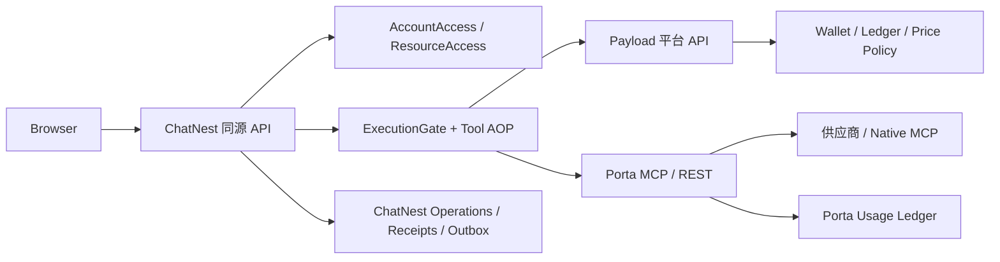
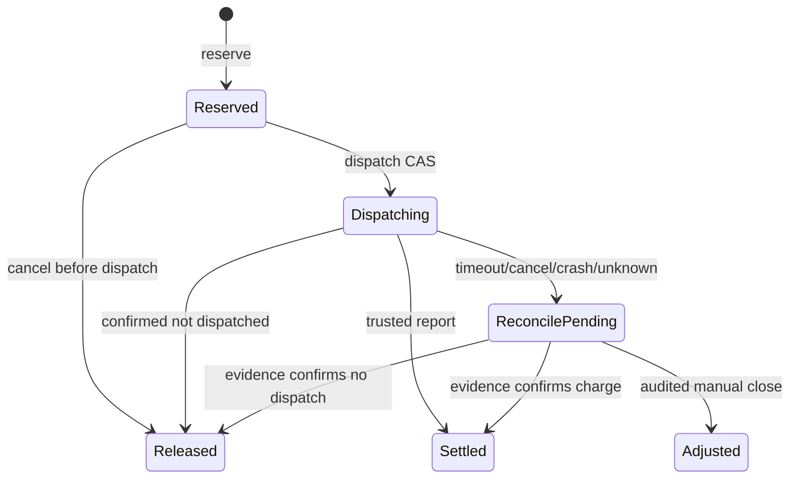

# ChatNest / Payload / Porta 平台积分与统一 AOP 技术方案 v2

日期：2026-10-30（America/New_York）  
状态：工程评审稿；本文件只定义方案，不代表代码已实现  
适用范围：ChatNest、独立 Payload 业务平台、Porta 工具服务  
前置文档：`docs/superpowers/specs/2026-10-30-platform-points-aop-design.md`

## 1. 执行摘要

本方案解决四个问题：

1. 用户账户、角色、权益、套餐和积分由谁负责；
2. 不同 Porta 工具如何使用不同积分规则；
3. 如何用一个统一的 TypeScript AOP 层覆盖 REST、HTTP MCP、Native MCP 和未来 provider；
4. 在超时、取消、重试、崩溃和响应丢失时，如何保证不重复出站、不重复扣分、可恢复可审计。

最终采用“三方分工、两层 AOP、一个积分账本”的结构：

- **Payload 平台**：账户、权限、价格、钱包和账务状态的唯一写入方；
- **ChatNest**：用户会话、资源属主、Agent 编排、审批、执行 operation 和结算 outbox；
- **Porta**：供应商访问、工具执行、供应商用量和执行 receipt；
- **ChatNest 外层 AOP**：用户积分准入与结算；
- **Porta 内层 AOP**：permit 校验与供应商用量计量；
- **平台积分账**：只存在于 Payload，不在 ChatNest 或 Porta 复制一份钱包。

一期不做通用表达式计价引擎，先支持固定调用价、显式免费、未定价拒绝和 metadata 四类策略。按页、按 URL、按供应商 credits 等动态计量在二期逐类加入。

## 2. 现状基线

### 2.1 ChatNest

ChatNest 当前已具备：

- Next.js 全栈单体和轻量 DDD 分层；
- 本地用户、会话、文件、产物和个人能力属主校验；
- Agent 自主模型调用、Ask、Todo、MCP 工具审批；
- MCP 工具动态发现、能力选择、配置修订和审批 CAS；
- `sendMessage` 统一模型执行入口；
- `createAgentRuntime` 统一 MCP 工具装配入口；
- 真实模型联调和 Porta 合成上游验收记录。

当前缺口：

- 没有平台账户主体映射和 connected 会话适配；
- 没有 `ExecutionGate`；
- 没有 `execution_operations`、执行 receipt 和 settlement outbox；
- 没有在真实模型/MCP 出站前执行积分 reserve/dispatch；
- 当前 `ResultEvidenceLedger` 只记录 Agent 证据，不是用户积分账。

### 2.2 Porta

Porta 当前已经有统一调用切面基础：

- 静态 provider 通过 `ProviderRegistry.execute`；
- Native MCP 通过 `NativeMcpBridge.aroundCall`；
- `UsageMeter.run()` 统一写 pending、完成状态、供应商用量和成本估算；
- SQLite usage ledger 支持游标查询、健康检查和 pending fail-closed；
- `tools/list` 与业务调用已经区分 metadata/business。

当前缺口：

- 没有客户身份、用户钱包或积分冻结；
- `pointsPrice` 目前只是未定价 metadata；
- `X-Porta-Task-Id` 只是关联字段，不能作为扣费授权；
- 没有 permit 验证和平台 receipt 协议。

### 2.3 Payload 平台

当前工作区没有 Payload 业务应用仓库。本文将 Payload 平台定义为独立部署单元，拥有独立 PostgreSQL、迁移、密钥、后台和发布周期。ChatNest 不安装 Payload 框架依赖，不直接访问平台数据库。

## 3. 设计目标与非目标

### 3.1 目标

- 账户、权益和积分规则只实现一次；
- 不同工具可以拥有不同固定积分；
- 价格变化只影响新 operation；
- 用户积分与供应商成本严格分账；
- 工具调用前可阻止余额不足和未授权出站；
- 工具调用后可以恢复结算；
- REST、MCP、Native MCP 使用同一 AOP 语义；
- standalone 可独立运行，connected 不存在免费旁路；
- 用 TypeScript 类型系统和运行时 schema 同时约束协议。

### 3.2 非目标

- 支付、订阅续费、邀请返利；
- 积分到期、周期清零和积分批次；
- 团队钱包和复杂多租户结算；
- 任意公式、脚本或用户自定义计价规则；
- 自动后台任务、供应商账单代付；
- 旧账号、旧业务数据和旧账本迁移。

## 4. 总体架构



### 4.1 数据所有权

| 数据 | 唯一写入方 | 其他服务可见内容 |
|---|---|---|
| 用户账户、角色、权益 | Payload | ChatNest 读取经过验证的投影 |
| 本地 actor、聊天、文件、产物 | ChatNest | Payload 不直接读业务表 |
| 工具价格策略 | Payload | ChatNest 读取 reserve 结果；Porta 只校验 permit |
| 用户钱包、积分账本 | Payload | ChatNest 读取余额/使用记录 |
| 供应商调用事实和成本 | Porta | ChatNest 读取 receipt 摘要 |
| Agent 工具输出和来源 | ChatNest | 不写入平台账本 |

### 4.2 调用方向

1. 浏览器只调用 ChatNest。
2. ChatNest 使用服务凭据和用户平台会话调用 Payload。
3. ChatNest 使用 Porta 服务令牌调用 Porta。
4. Porta 不访问 Payload 钱包，不接收浏览器身份，不向模型暴露计费字段。

## 5. 异构工具计价模型

### 5.1 为什么不能只做 `tool -> points`

当前 Porta 已接入的供应商计量存在明显差异：

- 固定一次调用；
- basic/advanced/image 等参数档位；
- 按页、按 URL、按返回记录；
- 供应商返回 credits；
- 异步任务按事件或运行量；
- 公开免费但仍可能受账号额度限制；
- 商业价格未核实。

因此产品积分策略必须和 Porta 的供应商成本估算分离。

### 5.2 一期策略类型

```ts
type ToolPricePolicy =
  | {
      kind: "fixed_call";
      points: string;
      unit: "call";
      chargeMode: "attempt" | "success";
    }
  | {
      kind: "included";
      points: "0";
      unit: "call";
    }
  | {
      kind: "metadata";
    }
  | {
      kind: "quote_required";
    };
```

二期再增加：

```ts
type MeteredPricePolicy = {
  kind: "reported_unit";
  unit: "credit" | "page" | "record" | "url";
  pointsPerUnit: string;
  reserve: "fixed_cap" | "max_from_args";
  chargeMode: "attempt" | "success";
};
```

一期禁止把任意 JavaScript 表达式、脚本或未验证供应商字段直接作为计价规则。

### 5.3 策略分类

| 类型 | 例子 | 一期行为 |
|---|---|---|
| `fixed_call` | 商品搜索、商品详情 | reserve 固定积分，按规则 capture/release |
| `included` | 明确承担成本的公共元数据 | 显式 0 分执行 |
| `metadata` | tools/list、服务发现 | 不创建用户积分 operation |
| `quote_required` | 未核实价格或动态计量不完整 | connected 拒绝 |
| `reported_unit` | OCR 页数、搜索 credits | 二期实现上限预留和实际结算 |

### 5.4 价格解析顺序

```text
账号/套餐覆盖价格
  > 工具专属价格
    > 产品级默认价格（未来）
      > default=deny
```

ChatNest 不自行计算价格；reserve 请求只携带 canonical tool identity 和受控的 billing dimensions，平台返回锁定后的价格快照。

## 6. Canonical Tool Identity

统一键：

```text
provider/platform/api
```

示例：

```text
onebound/1688/item_search
onebound/1688/item_get
native_mcp/alibaba1688_product/find_product
native_mcp/tavily/search
```

禁止使用：

- UI 显示别名；
- `porta__` 前缀；
- 模型生成的名称；
- 客户端传入的价格 key。

如果同一产品能力由不同供应商提供，默认仍按 provider/platform/api 分别定价。以后需要统一产品价格时，再增加受控 `billingKey`，但不在一期引入。

## 7. 三方 TypeScript 协议

三方仓库保持独立，不互相 import 源码。协议采用 OpenAPI/JSON Schema 作为外部规范，各仓库本地用 TypeScript + Zod 实现。

### 7.1 ID 品牌类型

```ts
type Brand<T, Name extends string> = T & {
  readonly __brand: Name;
};

type OperationId = Brand<string, "OperationId">;
type AttemptId = Brand<string, "AttemptId">;
type HoldId = Brand<string, "HoldId">;
type ReceiptId = Brand<string, "ReceiptId">;
```

### 7.2 工具调用上下文

```ts
type ToolIdentity = {
  provider: string;
  platform: string;
  api: string;
};

type ToolCallContext = {
  identity: ToolIdentity;
  operationId: OperationId;
  attemptId: AttemptId;
  taskId: string | null;
  toolCallId: string;
  argsDigest: string;
};
```

### 7.3 AOP 类型

```ts
type AroundCall = <T>(
  context: ToolCallContext,
  next: () => Promise<T>,
) => Promise<T>;
```

AOP 必须满足：

- `next()` 至多执行一次；
- 业务重试不在 middleware 内隐式发生；
- 所有副作用都关联 operation/attempt；
- 中间件顺序固定且可测试；
- 未知状态使用 exhaustive check。

## 8. 平台 API v1

### 8.1 账户与权益

```text
GET  /api/platform/v1/capabilities
POST /api/platform/v1/identity/register
POST /api/platform/v1/identity/login
POST /api/platform/v1/identity/refresh
POST /api/platform/v1/identity/logout
GET  /api/platform/v1/identity/me
GET  /api/platform/v1/me/access
GET  /api/platform/v1/me/wallet
GET  /api/platform/v1/me/ledger
```

### 8.2 operation 账务

```text
POST /api/platform/v1/operations/reserve
POST /api/platform/v1/operations/{operationId}/dispatch
POST /api/platform/v1/operations/{operationId}/report
GET  /api/platform/v1/operations/{operationId}
POST /api/platform/v1/operations/{operationId}/cancel
```

写请求统一要求：

- 服务认证；
- 已验证用户平台会话；
- `Idempotency-Key`；
- `X-Request-Id`；
- `apiVersion`；
- 服务端生成的 subject、operation 和价格，不接受客户端覆盖。

## 9. 账务状态机

### 9.1 operation 状态



### 9.2 余额不变量

```text
available = ledgerBalance - frozen
ledgerBalance >= frozen >= 0
```

余额、冻结、operation、账本事件、审计事件和 outbox 必须在同一个平台事务内提交。

### 9.3 固定调用流程

```text
reserve exact points
→ dispatch once
→ Porta permit validation
→ supplier call once
→ receipt
→ capture or release
```

### 9.4 动态计量流程（二期）

```text
reserve fixed cap / max units
→ dispatch
→ supplier returns trusted units
→ settle actual points
→ release surplus hold
```

没有可信上限时，connected 模式拒绝执行，而不是先执行后猜测。

## 10. ChatNest 外层 AOP

统一装配位置：`server/infrastructure/mcp/runtime.ts` 的动态工具执行外层，由 `sendMessage` 注入 `ExecutionGate`。

执行顺序：

```text
1. 解析 canonical identity
2. 检查任务能力、审批和账号状态
3. 创建 operationId / attemptId
4. 写入本地 execution_operations
5. 调平台 reserve
6. 调平台 dispatch
7. 使用 AsyncLocalStorage 注入 permit
8. 调用 remote.execute 一次
9. 读取 Porta receipt
10. 写入本地 receipt + settlement outbox
11. 调平台 report
12. 继续现有 evidence/source/result-table 流程
```

模型参数和积分字段不进入工具 schema、工具 arguments、prompt 或用户消息。

## 11. Porta 内层 AOP

Porta 保留现有入口：

- 静态 provider：`ProviderRegistry.execute`；
- Native MCP：`NativeMcpBridge.aroundCall`；
- 统一用量：`UsageMeter.run()`。

新增 permit/receipt middleware 后，顺序为：

```text
permit verify
→ usage ledger reserve
→ bounded upstream execution
→ usage ledger finish
→ signed receipt
```

Porta 模式：

```dotenv
PORTA_BILLING_MODE=off|receipt|required
PORTA_USAGE_SIGNING_KEY=TOKEN
PORTA_USAGE_SIGNING_KEY_ID=KEY_ID
```

- `off`：完全独立运行；
- `receipt`：可接收 permit 并生成 receipt，不强制平台；
- `required`：非零业务工具无有效 permit 时，供应商出站为 0。

permit 可有短期密码学有效期用于防重放，但不等于积分 hold 自动过期。

## 12. 统一积分 env 与生产价格源

### 12.1 env 种子

```dotenv
PLATFORM_TOOL_POINTS_JSON={"version":"2026-10-30.1","default":"deny","tools":{"onebound/1688/item_search":{"kind":"fixed_call","points":"2","unit":"call","chargeMode":"attempt"},"onebound/1688/item_get":{"kind":"fixed_call","points":"3","unit":"call","chargeMode":"attempt"},"native_mcp/alibaba1688_product/find_product":{"kind":"fixed_call","points":"5","unit":"call","chargeMode":"attempt"},"crossref/works/get_work":{"kind":"included","points":"0","unit":"call"}}}
```

约束：

- points 为非负十进制整数字符串；
- 默认策略为 deny；
- 只有显式 `included` 才能为 0；
- 价格策略必须有 version；
- 重复 key、非法 kind、负数、浮点数和未知 chargeMode 启动时拒绝；
- env 只用于种子和测试，生产价格由 Payload `tool_prices` 表管理。

### 12.2 不允许的配置方式

- ChatNest 和 Porta 各自维护一份生产价格；
- 将供应商美元、credits 或免费状态直接换成用户积分；
- 将 points 作为 MCP 工具参数；
- 让浏览器提交价格或用户身份；
- 用任意 JSONPath/JavaScript 表达式动态算价。

## 13. 错误、恢复与幂等

| 场景 | 结果 |
|---|---|
| 余额不足 | `409 INSUFFICIENT_CREDITS`，Porta 出站 0 |
| 账户停用/权限变化 | `403`，不使用旧缓存放行 |
| 未配置价格 | `422 PRICE_NOT_PUBLISHED`，不执行 |
| 平台不可用且未 reserve | connected 暂停，不切 standalone |
| reserve 响应丢失 | 原 Idempotency-Key 查询，不重复 hold |
| dispatch 响应丢失 | 查询 operation，不重复 permit/出站 |
| permit 缺失或错绑 | Porta `403`，供应商出站 0 |
| 明确失败 | 按 chargeMode capture 或 release |
| 超时/取消/崩溃 | `reconcile_pending`，不自动重试 |
| report 响应丢失 | settlement outbox 用同键重报 |
| Porta ledger 写失败 | fail-closed，阻止后续出站 |
| 结果已落库但结算未完成 | 保留结果，账务状态仍是待处理 |

## 14. 安全与隐私

- 浏览器不可见平台 service token、Porta token、permit 签名密钥和供应商 Key；
- permit 不进入模型上下文或用户可编辑内容；
- 账本只保存摘要、ID、价格版本、状态和 receipt 引用；
- 原始参数、响应正文、案件材料和 Key 不进入积分账本；
- 运营人员默认不能读取私有聊天、文件、skills 正文和连接凭据；
- `X-Porta-Task-Id` 只做关联，不做身份和扣费授权；
- 密钥轮换使用 `keyId`，旧 key 在受控窗口内只读验证。

## 15. 观测与审计

每次 operation 至少可关联：

```text
traceId
operationId
attemptId
toolIdentity
priceVersion
policyRevision
receiptId
outcome
```

指标：

- reserve 成功/失败；
- dispatch 竞争失败；
- permit 拒绝；
- supplier outcome；
- report/reconcile_pending；
- 重复幂等命中；
- 价格未发布；
- 账本写入失败。

## 16. 分阶段实施

### P0：目录与协议冻结

- 盘点所有 Porta 工具并分类；
- 冻结 canonical identity；
- 冻结错误码和 operation 状态；
- 建立 OpenAPI/JSON Schema fixtures；
- 明确 Payload 平台仓库和部署边界。

### P1：固定调用积分 MVP

- Payload 账户、权益、tool_prices、wallet、ledger、operations；
- ChatNest external identity、ExecutionGate、operations/outbox；
- Porta permit/receipt middleware；
- fixed_call、included、metadata、quote_required；
- connected/standalone/required 三种模式。

### P2：动态计量

- reported_unit；
- reserve cap；
- 供应商可信 units；
- surplus release；
- 逐供应商验收。

### P3：套餐与运营

- 套餐覆盖价；
- 工具白名单；
- 内部账号免费策略；
- 管理员发放、补偿、人工结案；
- 审计与账单导出。

### P4：灰度与真实验收

- 真实模型；
- 真实 Porta 账号；
- 真实供应商账单核对；
- 并发、停止、超时、恢复和备份演练；
- connected 灰度发布。

## 17. 进入实现的验收门槛

在生产代码开始前必须确认：

1. 工具价格策略类型已冻结；
2. 一期固定调用范围已列出；
3. `attempt`/`success` 语义已按工具确认；
4. Payload 平台仓库和部署责任已明确；
5. API 错误码、幂等键和状态机已冻结；
6. OpenAPI/JSON Schema fixture 可供三方契约测试共用；
7. connected 不存在免费旁路；
8. Porta supplier cost 与用户 points 的展示和存储边界已分开。

