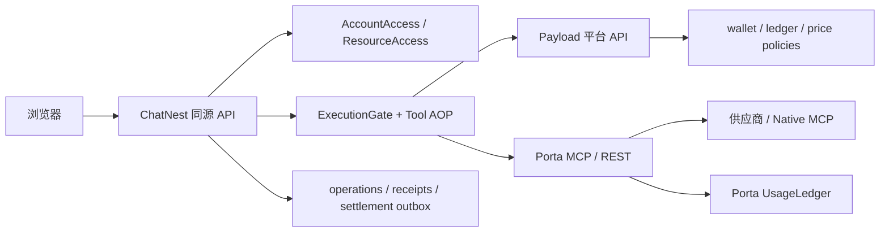
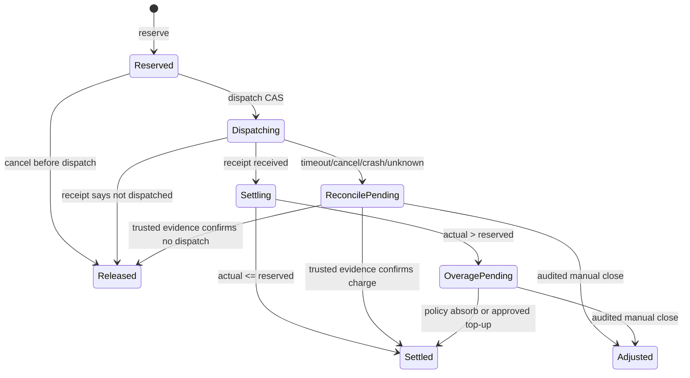

# ChatNest / Payload / Porta 平台积分与统一 AOP 技术方案

**版本：** v3.0 终版评审稿  
**日期：** 2026-10-30（America/New_York）  
**状态：** 实施前冻结稿；代码尚未实现  
**覆盖：** 账户、权限、工具价格、模型/工具积分、Porta AOP、账务状态机、幂等、恢复、审计和运营  
**关联：**

- `docs/superpowers/specs/2026-10-30-platform-points-aop-design.md`
- `docs/superpowers/specs/2026-10-30-platform-points-alignment-review.md`
- `docs/01_架构决策/20261030平台积分AOP技术方案-v2.md`
- `../porta/docs/platform-points-contract.md`

---

## 0. 最终决策摘要

### 0.1 三方职责

| 系统 | 唯一业务职责 | 明确不负责 |
|---|---|---|
| Payload 平台 | 用户、角色、权益、套餐、工具价格、钱包、积分账本、结算状态 | 不执行 Agent 工具、不读 ChatNest 业务表、不实现供应商适配器 |
| ChatNest | 浏览器会话、外部主体映射、资源属主、Agent 编排、审批、执行 operation、结算 outbox | 不复制套餐算法、不复制价格表、不持有第二个用户钱包 |
| Porta | provider/native MCP 执行、供应商认证、供应商用量、permit 校验、执行 receipt | 不持有用户钱包、不决定用户价格、不调用平台扣分 API |

### 0.2 一条完整闭环

```text
登录
 → 账户/权益校验
 → Agent 任务范围与工具审批
 → 价格策略解析
 → 积分 reserve
 → dispatch 一次执行许可
 → ChatNest AOP 调 Porta
 → Porta permit 校验
 → Porta UsageLedger.pending
 → 供应商出站一次
 → Porta receipt
 → ChatNest 保存结果与 outbox
 → 平台 capture / release / reconcile
 → 用户余额与使用记录更新
```

### 0.3 一期和二期的关系

不再实现两套架构。首版一次完成：

- 固定调用价；
- 参数档位价；
- 受控动态计量；
- 显式免费；
- 未定价拒绝；
- metadata 不扣分；
- 同一套 reserve/dispatch/report/reconcile。

差异只在于首版开放哪些工具。没有可信上限或可信 usage 的工具保持 `quote_required`，不猜测、不自动放行。

---

## 1. 不可破坏的不变量

以下不变量是实现、测试和运营的共同验收标准：

1. **单一钱包：** 用户积分余额只由 Payload 写入。
2. **单一价格源：** 生产价格只由 Payload 当前有效版本决定；env 仅为种子/测试配置。
3. **一次派发：** 一个 `operationId + attemptId` 最多进入一次真实供应商出站。
4. **一次结算：** 一个 operation 最多产生一次 capture、release 或 audited adjustment。
5. **不猜未知：** 超时、崩溃、响应丢失不能直接判定免费或成功扣费。
6. **不接受客户端价格：** points、priceVersion、userId、role、wallet 不信任客户端输入。
7. **账目分离：** 用户积分、供应商成本、Agent 证据是三本不同的账。
8. **无隐式旁路：** connected 模式平台不可用时不切换本地 guest、管理员白名单或无限额度。
9. **工具发现不收费：** tools/list、服务发现、schema 校验失败不创建用户积分 operation。
10. **历史不可重算：** 价格版本、策略版本和结算金额写入 operation 快照，后续改价不回写历史。

---

## 2. 当前基线与改造差距

### 2.1 ChatNest 已有能力

- 本地账号、会话和用户 UUID；
- 聊天、文件、产物和个人能力属主检查；
- MCP 配置、动态发现、任务能力范围、审批 CAS；
- `sendMessage` 统一模型执行入口；
- `createAgentRuntime` 统一 MCP tool 装配；
- `ResultEvidenceLedger` 记录工具来源和结果证据。

### 2.2 ChatNest 缺口

- `external_identities`；
- connected `AccountAccess`；
- `ExecutionGate`；
- `execution_operations`；
- `execution_receipts`；
- `settlement_outbox`；
- 平台 wallet/ledger 查询 UI；
- MCP transport 的单调用 permit 注入。

### 2.3 Porta 已有能力

- `ProviderRegistry.execute` 统一静态 provider 执行入口；
- `NativeMcpBridge.aroundCall` 统一 Native MCP 入口；
- `UsageMeter.run()` 统一 pending、完成状态、供应商单位和成本估算；
- SQLite usage ledger、ready 检查、pending fail-closed；
- metadata/business usage 区分；
- requestId/taskId 关联。

### 2.4 Porta 缺口

- permit 验证；
- signed receipt；
- connected `required` 模式；
- platform receipt 与 usage ledger 的关联字段。

### 2.5 Payload 现状

当前工作区没有 Payload 业务应用仓库。本方案先冻结独立平台协议和数据模型；平台仓库接入后必须以此契约实现，不直接与 ChatNest/Porta 共享数据库。

---

## 3. 架构边界和通信模型



### 3.1 同步与异步

| 场景 | 方式 | 原因 |
|---|---|---|
| 登录/权益读取 | 同步 HTTP | 需要立即反馈 |
| reserve/dispatch | 同步 HTTP + 幂等 | 必须在出站前阻止余额不足 |
| Porta 工具调用 | 同步 MCP/REST | 保留现有 Agent 工具语义 |
| report | 同步优先，outbox 恢复 | 结果不能因平台短暂故障丢失 |
| 人工核对/补偿 | 异步后台任务 | 不阻塞用户请求 |

不引入 Kafka 或通用工作流引擎。ChatNest 和 Payload 的 outbox/worker 先满足单应用、单数据库和小规模部署。

### 3.2 部署模式

| 模式 | 账户来源 | 积分 | Porta permit |
|---|---|---|---|
| `standalone` | ChatNest 本地账号兼容层 | 不启用用户积分 | `off` 或 `receipt` |
| `connected` | Payload 平台账户 | 必须经过平台 | `required` |

仅修改环境变量不能把已经登记为 connected 的部署切换成 standalone；模式写入部署绑定和 `modeEpoch`。

---

## 4. 异构工具计价模型

### 4.1 为什么必须是策略而不是数字

当前工具的计量可能是：

- 固定一次调用；
- basic/advanced/image 参数档位；
- page、url、record；
- supplier credits；
- 异步任务事件；
- 公开免费但有账号额度；
- 价格或收费条件未确认。

用户积分不能直接等同于供应商美元、credits 或 provider 的免费分类。平台必须维护独立的产品价格策略。

### 4.2 统一策略联合

```ts
type Brand<T, Name extends string> = T & {
  readonly __brand: Name;
};

type DecimalString = Brand<string, "DecimalString">;
type ChargeMode = "attempt" | "success";

type FixedCallPolicy = {
  kind: "fixed_call";
  points: DecimalString;
  unit: "call";
  chargeMode: ChargeMode;
};

type TieredCallPolicy = {
  kind: "tiered_call";
  dimension: "mode" | "operation" | "quality";
  tiers: Readonly<Record<string, DecimalString>>;
  chargeMode: ChargeMode;
};

type ReportedUnitPolicy = {
  kind: "reported_unit";
  unit: "credit" | "page" | "url" | "record";
  pointsPerUnit: DecimalString;
  reserve: {
    strategy: "fixed_cap" | "max_from_dimensions";
    capUnits: bigint;
  };
  overage: "manual_review" | "platform_absorb";
  chargeMode: ChargeMode;
};

type IncludedPolicy = {
  kind: "included";
  points: "0";
  unit: "call";
};

type MetadataPolicy = { kind: "metadata" };
type QuoteRequiredPolicy = { kind: "quote_required" };

type ToolPricePolicy =
  | FixedCallPolicy
  | TieredCallPolicy
  | ReportedUnitPolicy
  | IncludedPolicy
  | MetadataPolicy
  | QuoteRequiredPolicy;
```

### 4.3 策略决策

| 策略 | 预留 | 结算 | 首版条件 |
|---|---|---|---|
| `fixed_call` | exact points | exact capture/release | 立即支持 |
| `tiered_call` | resolve 后 exact points | exact capture/release | 只允许有限枚举维度 |
| `reported_unit` | cap × points/unit | actual settle + surplus release | 必须有可信 cap 和 receipt units |
| `included` | 0 | 不记用户扣分 | 必须显式发布 |
| `metadata` | 不创建用户 operation | 不扣分 | tools/list/discovery |
| `quote_required` | 拒绝 | 不出站 | 未核实或无法安全计量 |

### 4.4 价格解析顺序

```text
账号/套餐覆盖
  → 工具专属策略
    → 产品级默认策略（未来）
      → default=deny
```

每次 reserve 锁定：

- `pricePolicyId`；
- `priceVersion`；
- `policyRevision`；
- `reservedPoints`；
- `billingDimensionsDigest`。

### 4.5 计价事实的可信来源

工具参数本身不等于可信计量。设计分三层：

1. **ChatNest dimensions**：只提交平台允许的有限枚举和有界整数，例如 `mode=advanced`、`requestedPages=3`；
2. **Porta receipt**：返回实际 provider/api、outcome、supplier units 和受控 usage dimensions；
3. **Platform validator**：比较 reserve dimensions 与 receipt dimensions，发现降级伪造或超量时进入 `overage_pending` 或 `reconcile_pending`。

不把任意原始参数、JSONPath 或 JavaScript 表达式交给平台执行。

### 4.6 动态计量的规则

- 必须在出站前得到 cap；
- cap 可以来自固定策略、有限 dimensions 或供应商约束；
- actual usage 只能来自签名 receipt；
- actual 小于 cap：capture actual、release surplus；
- actual 大于 cap：进入 `overage_pending`，不自动追加扣分；
- 无法计算 cap：`quote_required`，不执行。

---

## 5. Canonical Tool Identity

统一键：

```text
provider/platform/api
```

示例：

```text
onebound/1688/item_search
onebound/1688/item_get
native_mcp/alibaba1688_product/find_product
native_mcp/tavily/search
```

禁止使用 UI alias、`porta__` 名称、模型生成名称或客户端自定义价格键。

Native MCP 的 canonical identity 来自 Porta 受信任的 native metadata，而不是 ChatNest 自己猜测。历史 alias 只能用于展示，不能用于账务匹配。

---

## 6. 三方协议

### 6.1 通用请求头

| Header | 来源 | 作用 |
|---|---|---|
| `Authorization` | 服务端 | 服务身份 |
| `X-Platform-User-Token` | ChatNest 服务端 | 已验证平台用户会话 |
| `X-Request-Id` | 调用方/服务端 | 请求追踪 |
| `Idempotency-Key` | ChatNest 服务端 | 账务命令幂等 |
| `X-Porta-Task-Id` | ChatNest → Porta | 任务关联，不是授权 |
| `X-Porta-Execution-Permit` | ChatNest → Porta | 单次执行 permit |

浏览器不得直接发送服务 token、permit、points、wallet 或 supplier Key。

### 6.2 平台 API

```text
GET  /api/platform/v1/capabilities
POST /api/platform/v1/identity/register
POST /api/platform/v1/identity/login
POST /api/platform/v1/identity/refresh
POST /api/platform/v1/identity/logout
GET  /api/platform/v1/identity/me
GET  /api/platform/v1/me/access
GET  /api/platform/v1/me/wallet
GET  /api/platform/v1/me/ledger
POST /api/platform/v1/operations/reserve
POST /api/platform/v1/operations/{operationId}/dispatch
POST /api/platform/v1/operations/{operationId}/report
GET  /api/platform/v1/operations/{operationId}
POST /api/platform/v1/operations/{operationId}/cancel
```

### 6.3 reserve 请求

```json
{
  "apiVersion": "v1",
  "operationId": "op_...",
  "attemptId": "att_...",
  "subjectType": "tool",
  "tool": {
    "provider": "onebound",
    "platform": "1688",
    "api": "item_search"
  },
  "billingDimensions": {
    "mode": "basic"
  },
  "chatnest": {
    "deploymentId": "deployment_...",
    "runId": "run_...",
    "chatId": "chat_..."
  }
}
```

平台返回：

```json
{
  "operationId": "op_...",
  "holdId": "hold_...",
  "pricePolicyId": "tool-price_...",
  "priceVersion": "2026-10-30.1",
  "reservedPoints": "2",
  "state": "reserved",
  "policyRevision": "42"
}
```

### 6.4 dispatch 返回

```json
{
  "operationId": "op_...",
  "attemptId": "att_...",
  "state": "dispatching",
  "permit": {
    "keyId": "platform-key-1",
    "expiresAt": "2026-10-30T12:00:05Z",
    "signature": "..."
  }
}
```

permit 的短期有效期只用于防重放；积分 hold 没有基于时间自动释放规则。

### 6.5 report 请求

```json
{
  "apiVersion": "v1",
  "operationId": "op_...",
  "attemptId": "att_...",
  "receipt": {
    "receiptId": "receipt_...",
    "receiptRevision": 1,
    "outcome": "response",
    "httpStatus": 200,
    "supplierUnits": { "pages": 3 },
    "billingDimensions": { "mode": "basic" },
    "signature": "..."
  }
}
```

平台只接受可信服务端 receipt，不接受浏览器提交的扣分数量。JSON 传输中的 points 和 supplier units 一律使用十进制字符串，服务端解析后才转 bigint；不在 HTTP JSON 中传输 JavaScript `bigint`。

### 6.6 响应丢失后的 receipt 查询

ChatNest 不能只依赖一次 MCP 响应完成结算。Porta 提供服务端专用查询：

```text
GET /internal/v1/receipts/{attemptId}
```

该接口只允许 ChatNest reconciliation service 使用独立服务凭据访问，返回 attempt 是否进入出站、receipt 是否完成、Porta usage outcome、HTTP 状态、supplier units、receipt revision 和签名；不返回原始参数、响应正文、供应商 Key 或用户钱包数据。

如果 Porta 也无法确认 attempt 状态，平台保持 `reconcile_pending`，由受控人工核对结案，不自动重发。

### 6.7 版本与兼容

- 所有请求携带 `apiVersion`；
- 新字段默认可选，旧客户端忽略未知响应字段；
- 删除字段、改变状态语义或改变签名 canonicalization 必须升主版本；
- permit 的 `protocolVersion` 与 Porta 支持集合必须匹配；
- 不兼容版本在 reserve 前拒绝，不进入供应商出站。

---

## 7. Permit 与 Receipt 安全协议

### 7.1 Permit 绑定字段

- `platformId`；
- `deploymentId`；
- `operationId`；
- `attemptId`；
- canonical tool identity；
- `pricePolicyId`；
- `priceVersion`；
- `reservedPoints`；
- `chargeMode`；
- `keyId`；
- `issuedAt` / `expiresAt`。

### 7.2 签名

默认采用 Ed25519：

```text
sign(canonical-json(payload), platform-private-key[keyId])
```

Porta 只保存受信任平台公钥，生产不共享平台私钥。开发夹具可以使用固定测试密钥，但不得进入生产配置。

connected 生产环境的服务间 HTTP 只允许 HTTPS，并校验固定 host/origin；开发回环可以显式允许 HTTP。服务 token 和 Ed25519 permit 是两层不同凭据：前者认证服务，后者授权一次 attempt，不能互相替代。

### 7.3 Replay 防护

Porta 本地保存最近 attempt 状态：

```text
attemptId unique
operationId + attemptId unique
permit signature digest unique
```

已消费 permit 再次到达时返回既有 receipt 或明确 replay 错误，不再次出站。

### 7.4 Key rotation

- permit 带 `keyId`；
- Porta 保留当前和上一把公钥；
- 平台先发布新公钥，再切换签名 key；
- 旧 key 过渡期只验证，不新签发；
- 删除旧 key 前必须确认无未结 operation。

---

## 8. 账务状态机

### 8.1 Operation 状态



### 8.2 允许的状态转换

```ts
type OperationState =
  | "reserved"
  | "dispatching"
  | "settling"
  | "settled"
  | "released"
  | "reconcile_pending"
  | "overage_pending"
  | "adjusted";
```

所有转换由单一纯函数执行：

```ts
function transition(
  state: OperationState,
  event: BillingEvent,
): OperationState;
```

非法转换抛出领域错误，不允许 repository 直接更新任意字符串状态。

### 8.3 Attempt 状态

operation 状态表示积分交易，attempt 状态表示一次实际出站尝试，两者不能混用：

```ts
type AttemptState =
  | "ready"
  | "sending"
  | "started"
  | "response"
  | "failed_before_dispatch"
  | "unknown";
```

`chargeMode=attempt` 只有在 Porta receipt 表明 `started`、`response` 或明确的供应商业务错误时才可 capture。`failed_before_dispatch` 必须 release；`unknown` 必须 reconcile。

### 8.4 余额不变量

```text
available = ledgerBalance - frozen
ledgerBalance >= frozen >= 0
```

平台事务锁定顺序固定为：

```text
wallet account → operation → idempotency row → ledger event → outbox
```

所有并发 reserve 走同一账户行锁或等价 serializable 约束。

### 8.5 固定调用

```text
reserve exact points
→ dispatch once
→ supplier call once
→ receipt
→ capture exact / release exact
```

`chargeMode=attempt`：确认已进入供应商出站即按固定价结算。  
`chargeMode=success`：只有可信成功 receipt 才结算，明确失败释放。

### 8.6 动态计量

```text
reserve cap
→ dispatch once
→ receipt reports actual units
→ capture actual
→ release surplus
```

实际 units 大于 cap：

- 不自动向钱包追加扣分；
- 进入 `overage_pending`；
- 按策略 `platform_absorb` 或 `manual_review` 处理；
- 记录价格版本、cap、actual 和原因。

---

## 9. ChatNest 外层 AOP

### 9.1 装配点

统一装配在 `server/infrastructure/mcp/runtime.ts` 动态 tool 的 `remote.execute` 外层，由 `sendMessage` 注入已装配的 `ExecutionGate`。

静态模型工具、Ask、Todo、文档工具和浏览器工具继续使用现有逻辑；只有平台配置为 billable 的 Porta 工具进入用户积分 AOP。

### 9.2 执行顺序

```text
1. 解析 canonical tool identity
2. 校验账号、资源属主、任务能力和审批
3. 解析有界 billing dimensions
4. 生成 operationId / attemptId
5. ChatNest 同事务写 execution_operations=ready
6. 平台 reserve
7. 平台 dispatch
8. 本地 CAS ready → sending
9. AsyncLocalStorage 绑定 permit
10. remote.execute() 至多一次
11. 接收 Porta receipt
12. 本地写 execution_receipt + settlement_outbox
13. 平台 report
14. 继续 evidence/source/result-table 流程
```

### 9.3 单次派发门

两个 worker 同时拿到同一 dispatch 结果时：

- 只有一个 worker 能完成 `ready → sending` CAS；
- 其他 worker 只读取既有状态；
- sending worker 失联不因租约过期自动接管重发；
- 迟到 receipt 关联原 attempt，不创建新 attempt。

这只能保证“本系统对每个 attempt 至多一次出站”；外部供应商本身是否已处理请求，需要由 receipt 和 reconciliation 处理，不能宣称跨网络 exactly-once。

### 9.4 permit 注入

不把 permit 放进模型工具参数。MCP transport 的 `fetch` 包装器从 `AsyncLocalStorage` 读取当前调用上下文，在该次 JSON-RPC 请求中注入 `X-Porta-Execution-Permit`。

必须测试并发 tool call，证明不同异步链路不会串 permit。

### 9.5 模型 operation

模型请求与 Porta 工具调用共用平台钱包，但不是同一个 operation：

```text
subjectType=model  → ChatNest model adapter → platform report
subjectType=tool   → ChatNest Tool AOP → Porta receipt → platform report
```

一期模型默认只支持固定单次模型请求策略；token/page 等可信用量等 LiteLLM 接入后再启用 `reported_unit`。AI SDK 的多步执行按实际 provider request 生成 `stepId`，不把一整段 Agent 文字误算成一次供应商调用。

模型和工具不能共用同一个 operationId。一个模型请求触发多个工具时，账上是一个 model operation 加多个独立 tool operations。

---

## 10. Porta 内层 AOP

### 10.1 统一入口

- 静态 provider：`ProviderRegistry.execute` 包裹 `UsageMeter.run`；
- Native MCP：`NativeMcpBridge.aroundCall` 包裹 `UsageMeter.run`；
- metadata：只写内部 metadata usage，不进入用户积分账。

### 10.2 middleware 顺序

```text
permit verify
→ replay guard
→ UsageLedger.reserve
→ BoundedExecutor / upstream execution
→ UsageLedger.finish
→ signed receipt
```

### 10.3 Porta 模式

```dotenv
PORTA_BILLING_MODE=off|receipt|required
PORTA_USAGE_SIGNING_KEY=TOKEN
PORTA_USAGE_SIGNING_KEY_ID=KEY_ID
PORTA_RECONCILE_TOKEN=TOKEN
```

- `off`：Porta 独立运行；
- `receipt`：接受 permit 并生成 receipt，但不强制；
- `required`：非零业务工具没有有效 permit 时，供应商出站为 0。

Porta 不读取 `PLATFORM_TOOL_POINTS_JSON`，不解析用户套餐，也不调用 Payload 钱包。

### 10.4 Receipt 最小字段

```ts
type DispatchEvidence =
  | "not_dispatched"
  | "started"
  | "response"
  | "unknown";

type PortaUsageReceipt = {
  receiptId: ReceiptId;
  operationId: OperationId;
  attemptId: AttemptId;
  canonicalToolKey: string;
  dispatchEvidence: DispatchEvidence;
  outcome:
    | "response"
    | "timeout"
    | "cancelled"
    | "network_error"
    | "response_too_large";
  httpStatus: number | null;
  supplierUnits: Readonly<Record<string, DecimalString>>;
  billingDimensions: Readonly<Record<string, string | number | boolean>>;
  receiptRevision: number;
  signature: string;
};
```

`dispatchEvidence` 是 attempt 计费的关键，不能只依赖 HTTP status 或模型文字。

---

## 11. 数据模型

### 11.1 Payload 平台

| 表 | 关键字段 | 约束 |
|---|---|---|
| `platform_subjects` | issuer, subject, account_id, status | `(platform_id, issuer, subject)` 唯一 |
| `tool_price_policies` | canonical_key, policy_json, version, status | 同一 key 仅一个 active version |
| `wallet_accounts` | account_id, ledger_balance, frozen, revision | `balance >= frozen >= 0` |
| `wallet_ledger_events` | event_id, account_id, operation_id, delta, reason | append-only，event_id 幂等 |
| `billing_operations` | operation_id, attempt_id, state, policy_snapshot | `operation_id` 唯一，`(operation_id, attempt_id)` 唯一 |
| `billing_attempts` | operation_id, attempt_id, state, dispatch_evidence, receipt_id | 一个 attempt 至多一次 sending CAS |
| `billing_idempotency` | service_id, command, key, request_digest, response | 同键同摘要复用结果 |
| `billing_outbox` | command_id, operation_id, state, attempts | 只重试账务命令，不重试供应商调用 |
| `audit_events` | actor, action, target, reason, before/after digest | 不保存 secret/body |

### 11.2 ChatNest

| 表 | 作用 |
|---|---|
| `external_identities` | Payload subject 与 local actor UUID 映射 |
| `execution_operations` | 本地执行状态、run/chat/tool 关联、attempt CAS |
| `execution_receipts` | Porta receipt 不可变快照 |
| `settlement_outbox` | report/reconcile 账务命令恢复 |

### 11.3 Porta

沿用现有 usage ledger，新增：

- `operationId`；
- `attemptId`；
- permit digest；
- dispatch evidence；
- receipt revision；
- canonical tool identity 快照。

Porta ledger 不增加 wallet balance、customer id 或平台价格算法。

---

## 12. 配置与环境变量

### 12.1 Payload 平台

```dotenv
PLATFORM_ID=platform_...
PLATFORM_TOOL_POINTS_JSON={...}
PLATFORM_SIGNING_KEY_ID=platform-key-1
PLATFORM_SIGNING_PRIVATE_KEY=TOKEN
```

`PLATFORM_TOOL_POINTS_JSON` 是初始化和测试输入；生产后台写入 `tool_price_policies` 后，数据库版本优先。

启动种子只在价格表为空或显式 seed revision 未应用时写入；环境变量变更不会静默覆盖生产价格。生产调价必须通过 Payload 受控命令完成，并递增 price version/policy revision。

### 12.2 ChatNest

```dotenv
PLATFORM_MODE=standalone|connected
PLATFORM_BASE_URL=https://platform.example
PLATFORM_SERVICE_TOKEN=TOKEN
PLATFORM_SESSION_ENCRYPTION_KEY=TOKEN
CHATNEST_DEPLOYMENT_ID=deployment_...
CHATNEST_CONTROL_TOKEN=TOKEN
```

ChatNest 不保存生产工具价格副本。

### 12.3 Porta

```dotenv
PORTA_BILLING_MODE=off|receipt|required
PORTA_USAGE_SIGNING_KEY=TOKEN
PORTA_USAGE_SIGNING_KEY_ID=platform-key-1
PORTA_RECONCILE_TOKEN=TOKEN
```

所有 env 在启动时使用 Zod 严格解析。非法 points、负数、浮点数、重复 key、未知 policy kind、空签名 key 和不匹配 key id 都阻止 ready。

`PORTA_RECONCILE_TOKEN` 只允许 receipt 查询和恢复，不允许发现工具、调用 provider、修改配置或访问用户积分。

---

## 13. 错误与恢复矩阵

| 场景 | ChatNest | Payload | Porta | 供应商出站 |
|---|---|---|---|---:|
| 余额不足 | 显示余额不足 | `409 INSUFFICIENT_CREDITS` | 不接收调用 | 0 |
| 未发布价格 | 显示工具不可用 | `422 PRICE_NOT_PUBLISHED` | 不接收调用 | 0 |
| 账户停用 | 结束新执行 | `403 ACCOUNT_DISABLED` | 不接收调用 | 0 |
| reserve 超时 | 同 key 查询/待恢复 | 保留唯一 operation | 不接收调用 | 0 |
| dispatch 超时 | 查询 operation | 返回既有 dispatch 状态 | 不重复 permit | 至多一次 |
| permit 无效 | 工具错误 | 不改变钱包 | `403 INVALID_PERMIT` | 0 |
| 供应商明确失败 | 保存失败证据 | 按 chargeMode settle/release | receipt |
| 上游超时 | 保存中断/待核对 | `reconcile_pending` | usage pending/complete | 至多一次 |
| report 响应丢失 | outbox 重报 | 幂等返回原状态 | receipt 已存在 | 不重发 |
| ChatNest 不知道 Porta 是否出站 | 查询 internal receipt | 保持 `reconcile_pending` | 返回 dispatch evidence | 不重发 |
| 本地 receipt 落库失败 | 保留 sending | 不立即结算 | pending latch | 不重发 |
| actual > cap | 显示待核对 | `overage_pending` | receipt 保留 | 已发生 |
| Payload 不可用 | 暂停新计费调用 | 服务不可用 | 可独立 ready | 0 |

“至多一次”表示本系统不主动重发供应商调用，不表示网络世界提供数学意义上的 exactly-once。

---

## 14. 安全、隐私和权限

### 14.1 身份

- 浏览器只得到 ChatNest HttpOnly 会话；
- ChatNest 保存加密后的平台会话，不放入 localStorage、prompt、日志；
- 平台主体由验证后的 session 得出，不信任 `userId` body；
- 本地 actor 与 platform subject 一一映射；
- connected 模式禁止 guest 创建可执行的本地商业身份。

### 14.2 凭据

- Payload 私钥只在平台；
- Porta 公钥只用于 permit 验证；
- 供应商 Key 只在 Porta；
- ChatNest 个人 MCP Key 只在 ChatNest 加密存储；
- 日志、账本、receipt 不写 Key、原始参数和响应正文。

### 14.3 管理员

平台管理员可以管理账户、权益、价格和积分，但默认不能读取 ChatNest 私有对话、文件、skills 正文或连接 Key。配置操作使用专用 permission、commandId、reason 和 audit event。

---

## 15. 观测、SLO 和运营故事

### 15.1 必须关联的字段

```text
traceId
operationId
attemptId
receiptId
canonicalToolKey
pricePolicyId
priceVersion
policyRevision
outcome
```

### 15.2 初始工程目标

这些是工程目标，不是供应商 SLA：

- reserve/dispatch 平台请求 p95 ≤ 300ms（不含供应商调用）；
- permit 本地验证 p95 ≤ 5ms；
- AOP 额外本地开销 p95 ≤ 20ms；
- outbox 恢复任务每 30 秒扫描一次；
- `reconcile_pending` 和 `overage_pending` 必须可查询、可告警、可人工结案；
- 钱包账本 append-only，禁止直接 UPDATE 历史事件。

### 15.3 告警

- 钱包账本与冻结不变量破坏；
- Porta pending latch；
- reconcile_pending 超过运营阈值；
- overage_pending 增长；
- permit replay 或签名失败突增；
- report outbox 重试耗尽；
- 未定价工具尝试量；
- supplier cost 与用户 points 账面异常偏差。

### 15.4 备份与恢复

- Payload wallet、ledger、operations 和 outbox 必须进入同一备份策略；
- ChatNest execution operations、receipts 和 outbox 必须与业务数据库一起备份；
- Porta usage SQLite 必须使用独立私有卷和文件权限，不能依赖容器临时盘；
- 恢复后先执行账务 reconciliation，再开放新的 required 出站；
- 不通过清空 pending、删除历史账本或重新发起供应商请求“修复”数据。

---

## 16. TypeScript 实现约束

### 16.1 跨边界

- OpenAPI 3.1 / JSON Schema 是跨仓库规范；
- 各仓库本地生成或维护 DTO；
- 所有 HTTP 入站先 Zod parse，再进入 domain/application；
- 不跨仓库 import ORM 类型；
- JSON 数字积分不使用 JavaScript `number` 做结算。

### 16.2 AOP

```ts
type AroundCall = <T>(
  context: ToolCallContext,
  next: () => Promise<T>,
) => Promise<T>;
```

中间件顺序固定：

```text
identity/entitlement
→ price resolve
→ reserve
→ dispatch
→ local single-dispatch CAS
→ permit transport
→ Porta usage reserve
→ provider execution
→ receipt
→ settlement outbox
→ report
```

`next()` 至多调用一次；middleware 不负责业务自动重试。

### 16.3 状态机

状态转移必须是纯函数，repository 只保存转移后的合法状态。使用 `never` exhaustive check 防止新增状态遗漏结算分支。

### 16.4 数值与边界

- 用户 points 只允许非负整数；
- supplier units 使用 bigint 或受限十进制字符串，不使用浮点累加；
- 单次 reserve、账户余额、冻结量和 cap 必须有最大值；
- 任何乘法先做溢出检查，再写账本；
- canonical JSON 对 key 顺序、Unicode、数字格式和空值规则固定，签名两端使用同一实现 fixture。

---

## 17. 实施计划：一次闭环、分批开放

### Batch 0：契约冻结

- 冻结 canonical tool identity；
- 冻结策略联合、错误码和状态机；
- 建立 OpenAPI/JSON Schema fixtures；
- 明确 Payload 平台仓库、域名、数据库和密钥责任；
- 为现有工具建立 `fixed/included/metadata/quote_required/reported_unit` 分类表。

### Batch 1：首个完整闭环

同时实现：

- Payload wallet/ledger/operation/price policy；
- ChatNest external identity/ExecutionGate/operations/outbox；
- Porta permit/receipt/AOP；
- 一个固定价静态 provider；
- 一个固定价 Native MCP；
- 一个有可信 cap 的动态工具；
- 余额不足、停止、超时、响应丢失、重复提交、重启恢复。

### Batch 2：目录策略迁移

- 为每个 provider/platform/api 发布策略；
- 不完整的动态工具保持 quote_required；
- 逐供应商核对 receipt units、失败收费和异步证据；
- 对已发布 operation 不回写价格。

### Batch 3：平台运营

- Payload 后台价格编辑和版本；
- 套餐覆盖价和工具权益；
- 发放、补偿、人工结案；
- 使用记录和账单导出；
- 风险和异常告警。

### Batch 4：真实灰度

- 真实模型；
- 真实 Porta 账户；
- 真实供应商扣费/额度/错误；
- 并发、停止、崩溃、备份恢复；
- connected 灰度发布。

---

## 18. 评审验收矩阵

### 18.1 业务正确性

- 不同工具按不同 points 正确扣减；
- 同一工具不同 tier 按正确策略扣减；
- 显式免费工具扣 0；
- 未定价工具不出站；
- 动态工具按 cap reserve、actual settle、surplus release；
- actual > cap 进入 overage_pending，不自动超扣。

### 18.2 一致性

- 并发 reserve 不透支；
- 同 key reserve/dispatch/report 只执行一次；
- 两个 ChatNest worker 只有一个 sending CAS 成功；
- 供应商响应丢失不自动重发；
- report 响应丢失可由 outbox 恢复；
- 钱包账本可从 append-only events 重建。

### 18.3 安全

- 伪造 userId/points/role/price 被拒绝；
- permit 签名、tool、attempt、version 绑定校验；
- permit replay 不出站；
- key rotation 可验证旧 operation；
- token、Key、原始参数、响应正文不出现在日志和账本。

### 18.4 真实验收边界

- ChatNest UI、真实数据库和本地文件可真实验收；
- 模型验收单列真实模型证据；
- Porta 合成供应商数据必须显式标注；
- 真实供应商扣费、账户额度和账单核对单列，不由合成 fixture 代替。

---

## 19. 关键取舍与排除方案

### 19.1 Porta 直接持有用户钱包

**排除原因：** Porta 会同时承担供应商执行、客户身份、套餐和钱包，导致 Codex/CLI/其他宿主都被迫接入商业后端，也让工具服务无法独立运行。

### 19.2 只在工具返回后扣分

**排除原因：** 余额不足时仍可能发生供应商出站；超时、响应丢失和进程崩溃无法可靠区分免费与已执行。采用 reserve/dispatch/report 三段式。

### 19.3 ChatNest 与 Payload 共用数据库

**排除原因：** 迁移、权限、备份和发布周期耦合，绕过 HTTP 契约也会破坏单一写入方。两边保持独立数据库。

### 19.4 每个 provider 手写扣分逻辑

**排除原因：** REST、MCP、Native MCP 会出现分叉，新增 provider 容易漏扣或双扣。统一使用 ChatNest/Porta 两层 AOP。

### 19.5 宣称跨网络 exactly-once

**排除原因：** 外部供应商调用与本地数据库无法共享原子事务。系统承诺每个 attempt 至多一次出站、账务命令可幂等恢复，未知状态必须核对。

## 20. 最终冻结的默认值

1. 生产价格源：Payload `tool_price_policies`。
2. 初始种子：`PLATFORM_TOOL_POINTS_JSON`。
3. 未配置工具：`quote_required`/deny。
4. 固定工具默认：`chargeMode=attempt`。
5. 动态工具默认：必须 cap；actual 超 cap 进入 `overage_pending`。
6. 模型与工具：共用钱包，分开 operation 和展示分类。
7. Porta：不持有钱包，不调用平台扣分 API。
8. connected：无平台准入不出站；不切 standalone。
9. 供应商重试：积分控制路径和供应商业务调用均不自动重试。
10. 外部 exactly-once：不承诺；本系统承诺每个 attempt 至多一次出站、账务命令可幂等恢复。

满足以上默认值后，技术方案在产品规则、服务边界、数据所有权、动态计量、失败恢复和实现路径上闭合，可以进入 implementation plan 和 TDD 阶段。


## 2026-10-30 增补：模型 Agent 与会话级明细

- `sessionGroupId` 以 ChatNest 的 `chatId` 为稳定会话组键；一次用户消息使用 `runId` 标识本轮执行。
- 每一个 AI SDK provider request 都是一个独立 `billingOperation`，`subjectType=model`、`canonicalToolKey=model/<modelId>`；每一个 Porta 出站工具调用仍是 `subjectType=tool`。
- 统一 AOP 顺序为 `create -> reserve -> dispatch -> CAS(sending) -> provider/Porta -> report`。模型通过 `wrapLanguageModel` 的 `wrapGenerate` / `wrapStream` 接入，流消费完成后才结算，供应商未确定时进入 `reconcile_pending`。
- Payload `billingSessions` 聚合步骤，`billingOperations` 保存单步价格快照、模型/工具标识、状态、receipt；`GET /api/platform/v1/sessions/:sessionGroupId` 返回总预留、总扣除及按 `stepIndex` 的详细步骤。
- 用户侧读取路径为 ChatNest `GET /api/chat/billing?sessionGroupId=<chatId>`，只代理连接态 Payload 结果；断开连接或缺少用户平台会话时返回明确错误，不回退到免扣费。
- 模型与工具共用钱包，但分别配置 `billingPolicies`，因此可以对不同模型、不同工具配置不同积分；策略版本写入 permit 和 operation，保证历史账单可重放解释。
