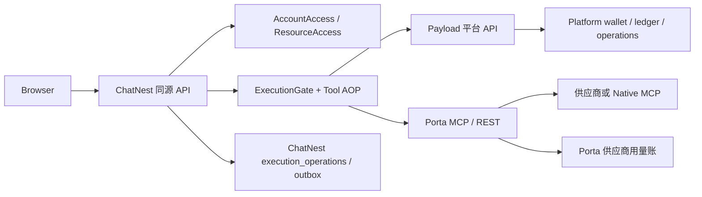
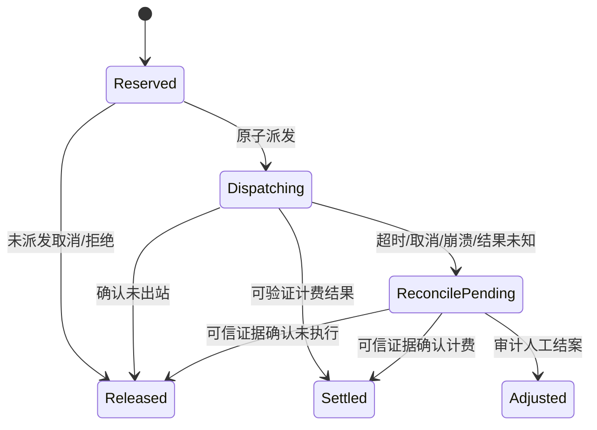

# ChatNest / Payload / Porta 平台积分与统一 AOP 技术方案

日期：2026-10-30（America/New_York）  
状态：方案评审稿，不含生产实现  
关联设计：`docs/superpowers/specs/2026-10-30-platform-points-aop-design.md`

## 1. 目标

建立一条可验证的账户、权限、模型/工具执行、积分冻结、供应商调用和结算闭环：

```text
登录 → 权益 → 任务范围 → 审批 → 积分预留 → 一次出站 → 收据 → 结算/释放 → 余额与账单
```

系统需要同时满足：

- 业务规则只在 Payload 平台实现一次；
- ChatNest 仍保留 Agent、资源属主、审批、产物和本地执行可靠性；
- Porta 继续是独立工具服务，不持有客户钱包；
- 所有 Porta 工具统一经过一个 TypeScript AOP 边界；
- 重复提交、停止、超时、断网、崩溃和响应丢失不造成重复供应商调用或重复扣分。

## 2. 现状与差距

### ChatNest

已具备本地账号、用户 UUID、个人能力、MCP 审批、Agent runtime 和结果证据账。现有 `sendMessage` 与 `createAgentRuntime` 没有平台准入、operation 持久化和积分结算。

### Porta

已具备 `UsageMeter.run()`、`NativeMcpBridge.aroundCall`、供应商 usage ledger、pending/complete/not_dispatched 和供应商成本快照。现有积分字段只是保留 metadata，不是客户积分。

### Payload

当前工作区没有 Payload 业务仓库；本方案把平台 API、账务表、权限和管理端定义为独立平台应用的实现边界。

## 3. 目标架构



### 责任边界

| 能力 | 唯一写入方 | 说明 |
|---|---|---|
| 账户、角色、权益 | Payload | 用户状态、角色、可用模型/工具、限额 |
| 本地 actor 与资源属主 | ChatNest | 聊天、文件、产物、个人凭据、任务选择 |
| 用户积分 | Payload | 余额、冻结、扣减、释放、补偿、账本 |
| 供应商成本与调用事实 | Porta | provider/platform/api、attempt、供应商单位和响应状态 |
| Agent 工具证据 | ChatNest | 消息、来源、结果表、审批和 UI 证据 |

## 4. TypeScript 设计

三方均使用 TypeScript，协议层采用：

- `zod`：HTTP DTO、环境变量、permit、receipt 运行时解析；
- branded string：避免 `operationId`、`attemptId`、`holdId`、`receiptId` 混用；
- discriminated union：账务状态只允许合法迁移；
- `never` exhaustive check：新增状态时强制补齐处理；
- 泛型 `AroundCall<T>`：REST、MCP、Native MCP 共用 AOP 类型；
- `AsyncLocalStorage`：把单次 permit 绑定到当前 transport fetch，不污染模型参数或全局配置。

核心模型：

```ts
type BillingState =
  | { kind: "reserved"; holdId: HoldId }
  | { kind: "dispatching"; attemptId: AttemptId }
  | { kind: "settled"; captured: bigint }
  | { kind: "released"; released: bigint }
  | { kind: "reconcile_pending"; reason: string }
  | { kind: "adjusted"; reason: string };
```

## 5. 三方协议

### 5.1 平台 API

- `GET /capabilities`
- `POST /identity/register|login|refresh|logout`
- `GET /identity/me`
- `GET /me/access`
- `GET /me/wallet`
- `GET /me/ledger`
- `POST /operations/reserve`
- `POST /operations/{id}/dispatch`
- `POST /operations/{id}/report`
- `GET /operations/{id}`
- `POST /operations/{id}/cancel`

所有写操作必须带服务凭据、用户平台会话、`Idempotency-Key`、`X-Request-Id` 和 API 版本。服务端不接受客户端传入价格、积分、角色或任意 userId 作为授权依据。

### 5.2 Porta permit 与 receipt

permit 绑定：

- `operationId`
- `attemptId`
- canonical tool identity：`provider/platform/api`
- 价格版本、收费模式、宿主 ID、密钥版本

Porta 只验证 permit、执行一次供应商调用并生成 receipt；不调用平台钱包 API，不保存客户余额。

### 5.3 ChatNest AOP

`createAgentRuntime()` 只负责装配工具；统一扣费 decorator 在动态 MCP tool 的 `remote.execute` 外层装配：

```text
ExecutionGate.reserve
  → ExecutionGate.dispatch
    → Porta permit middleware
      → Porta UsageMeter.reserve
        → provider/native MCP execute
      ← Porta UsageMeter.finish + receipt
  ← Platform.report
```

模型参数、工具参数、浏览器状态和 UI 消息不携带积分字段。

## 6. 账务状态机



平台余额定义：

```text
available = ledgerBalance - frozen
ledgerBalance >= frozen >= 0
```

余额、冻结、operation、账本事件和 outbox 必须在同一平台事务中提交。时间经过不自动释放或扣减积分。

## 7. 积分配置

启动阶段允许：

```dotenv
PLATFORM_TOOL_POINTS_JSON={"version":"2026-10-30.1","default":"deny","tools":{"onebound/1688/item_search":{"points":"2","unit":"call","chargeMode":"attempt"},"onebound/1688/item_get":{"points":"3","unit":"call","chargeMode":"attempt"}}}
```

正式运行时由 Payload `tool_prices` 表作为唯一价格源；env 仅作初始种子和本地测试覆盖。

推荐一期统一使用 `chargeMode=attempt`：真实供应商出站一次就按该工具调用扣分；出站前校验失败、审批拒绝和权限撤销不扣。超时和取消进入待核对，不直接判免费。

模型请求和 Porta 工具调用分别记账：模型是 `subjectType=model`，Porta 是 `subjectType=tool`，避免把一个 Agent 任务错误显示为一次调用。

## 8. 安全与隐私

- 浏览器永远看不到平台服务 token、Porta token、permit 签名密钥和供应商 Key。
- `X-Porta-Task-Id` 仅关联任务，不提供扣费权限。
- permit 使用 `keyId` 支持密钥轮换；密码学有效期用于防重放，不等于积分 hold 自动过期。
- 平台账本只保存摘要、operation、价格版本和收据引用，不保存原始参数、响应正文和案件材料。
- 运维人员默认只能查看账务元数据，不能读取 ChatNest 私有对话、文件、技能正文和连接 Key。

## 9. 可靠性与可观测性

- ChatNest 持久化 `execution_operations`、`execution_receipts`、`settlement_outbox`。
- Porta 保留现有 pending latch 和 fail-closed 行为。
- Platform report 只允许同一幂等键恢复，不允许重放供应商调用。
- 日志使用 traceId、operationId、attemptId、receiptId；不记录 token、原参数和响应正文。
- metrics 至少包含 reserve、dispatch、report、reconcile_pending、duplicate、rejected 和 supplier outcome。

## 10. 风险与取舍

| 风险 | 处理 |
|---|---|
| 三方价格源漂移 | Payload 价格表唯一运行源，reserve 锁版本 |
| MCP transport 无法携带逐调用 header | ChatNest transport fetch 使用 AsyncLocalStorage 注入 permit |
| 供应商已成功但本地响应丢失 | receipt + outbox + reconcile_pending |
| Porta 被绕过 | connected 的 `required` 模式要求 permit；standalone 明确不提供商业积分 |
| 用户误解模型费与工具费 | UI 按 model/tool 分组显示，账本字段明确 subjectType |
| 平台不可用 | connected 暂停新扣费调用，不切换本地无限额度 |

## 11. 实施前必须对齐的决策

1. 一期所有 Porta 工具是否统一按 `attempt` 计费；若不是，逐工具配置 `chargeMode`。
2. 模型积分和工具积分是否同时启用；默认建议分别记账、同一余额。
3. `PLATFORM_TOOL_POINTS_JSON` 是仅本地种子，还是允许生产临时覆盖；默认建议生产只读。
4. Payload 平台正式仓库名称、部署地址、服务认证和密钥轮换责任人。
5. connected 模式下未配置价格的工具是拒绝，还是显式免费；默认建议拒绝。

