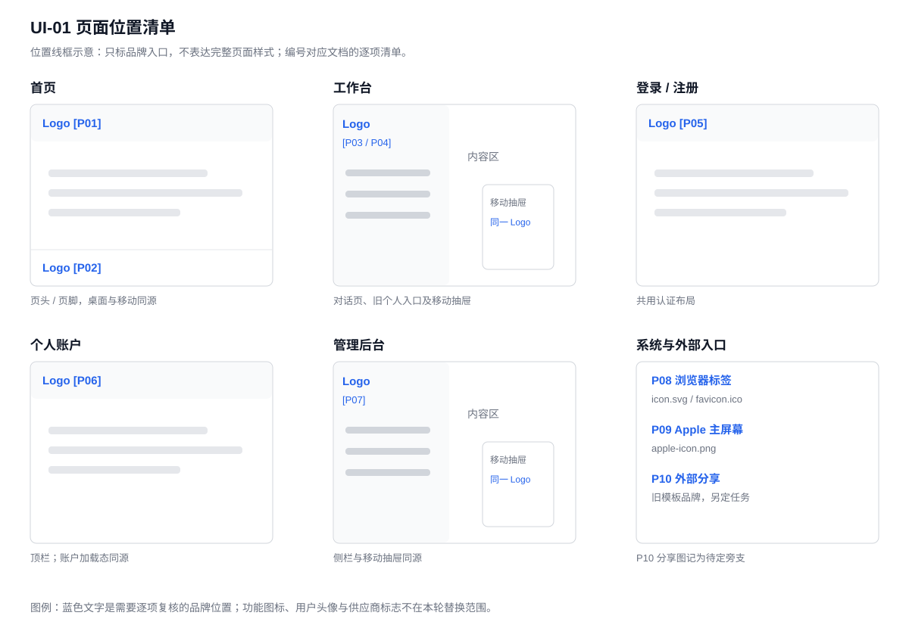
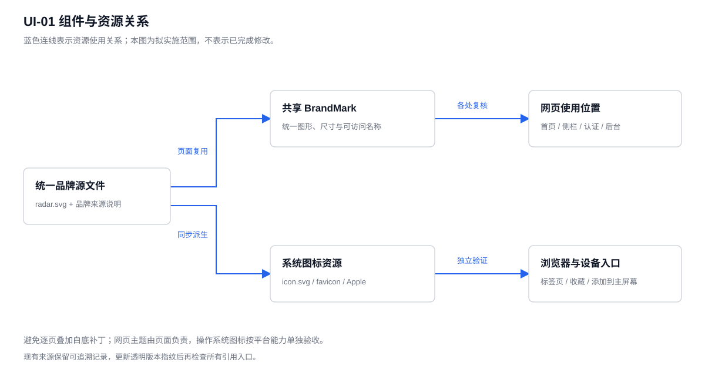

# UI 调整任务 01：Logo 透明背景

日期：2026-11-10。分支：`feat/ui-refinement`。状态：正式 SVG 已接入，本地首页与登录页已核对，待用户确认效果。

## 背景、目标与来源

原页面的白色方块来自 `public/brand/radar.svg` 的固定白底，在彩色和深色背景上显得突兀。用户选定 Figma「01 探索雷达」，随后提供一张 256×256 独立雷达图片确定外观，并明确要求正式资源使用 SVG。目标是保留蓝青配色、浅色圆环及白色十字，让同一图形自然适配不同页面背景。

原型：[数知探AI Logo 方案](https://www.figma.com/design/MLptHau7p11OMvS2mENdbL/?node-id=0-1)。[用户原图](assets/task-01/logo-original.png)用于核对造型；原始 Figma 矢量路径用于生成正式资源。

## 方案、改动与收益

交付：[透明纯矢量 radar.svg](../../../public/brand/radar.svg)。移除原白色底板及用户贴图中没有的右下角副标记，调整为 256×256 画布；保留原路径和品牌色。文件由路径与渐变组成，没有内嵌位图。画布外部及圆环内部透明，十字的白色属于图形本身。

页面继续通过 [BrandMark](../../../app/_components/brand-mark.tsx#L4) 引用 `/brand/radar.svg`，沿用 24／28／32px 等比尺寸、部署前缀和可访问名称。同步更新 `app/icon.svg`，由同一 SVG 派生 favicon 与 Apple 图标。收益是一次更新覆盖共享入口，缩放清晰，后续维护只需管理同一矢量来源。[透明 PNG](assets/task-01/logo-transparent.png)仅作效果对比参考。

## 页面与位置清单

| 标记 | 页面／界面位置 | 组件定位 |
| --- | --- | --- |
| P01 | `/` 页头，32px | [LandingPage:114](../../../app/_components/landing/landing-page.tsx#L114) |
| P02 | `/` 页脚，24px | [LandingPage:292](../../../app/_components/landing/landing-page.tsx#L292) |
| P03 | `/chat`、`/chat/[id]` 侧栏及移动抽屉，32px | [AppSidebar:64](../../../app/_components/chat/app-sidebar.tsx#L64) |
| P04 | `/?section=connections`、`/?section=skills` 登录后的旧入口 | [HomeEntry:14](../../../app/_components/landing/home-entry.tsx#L14)；同侧栏 |
| P05 | `/login`、`/register` 顶部，32px | [AuthLayout:21](../../../app/(auth)/layout.tsx#L21) |
| P06 | `/account`、`/account/billing`、`/account/billing/return`、`/account/usage`、`/account/settings`、`/account/organizations` 顶栏，28px | [AccountShell:76](../../../app/_components/account/account-shell.tsx#L76)；含加载态 |
| P07 | `/admin`、`/admin/connections`、`/admin/models`、`/admin/storage`、`/admin/accounts`、`/admin/billing` 侧栏及移动抽屉，28px | [AdminSidebar:126](../../../app/_components/admin/admin-shell.tsx#L126) |
| P08 | 浏览器标签／收藏 | `app/icon.svg`、`app/favicon.ico` |
| P09 | Apple 主屏幕图标 | `app/apple-icon.png` |
| P10 | 分享卡片 | `app/(chat)/opengraph-image.png`、`twitter-image.png`；旧模板品牌，另定任务 |

## 验证结果与决策边界

本地真实浏览器已核对首页页头、页脚及登录页：图片正常加载，SVG 返回 200，类型为 `image/svg+xml`，内容指纹与正式文件一致；画布外角和圆环内部采样透明度为 0。已查看首页及登录页效果，素材已检查白色与深色背景。品牌回归 9 项、类型检查及定向 Biome 检查通过。

账户、后台、移动端和 Apple 真机本轮未逐页验收。用户已确认独立雷达造型、蓝青色与 SVG 格式；P10 分享卡片后续单独决定。用户头像、供应商标志和功能图标不纳入本任务；组织页仍受既有开关控制。文档与配图统一收在本 FEAT 目录。
