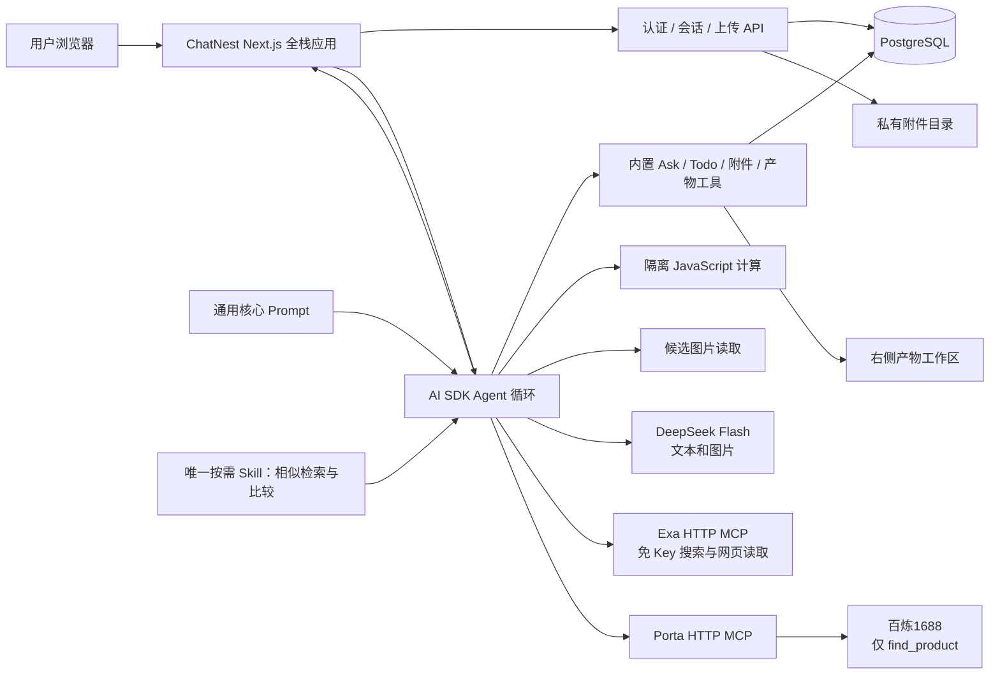

# ChatNest 代码库地图

> 模块现状的权威地图:改结构必看、必更(AGENTS.md 纪律 6)。分层演变史与逐轮裁决见 [01_架构决策/20261025101500_DDD分层待办P1-P4.md](01_架构决策/20261025101500_DDD分层待办P1-P4.md);逐轮功能验证记录见 `docs/superpowers/plans/`。

## 项目仓库边界（2026-11-06 核对）

项目仅包含 `nodetime/payload`（业务后端承载仓库）、`nodetime/chatnest`（Chat/Agent 应用）、`nodetime/porta`（MCP 服务）、`nodetime/porta-cli`（CLI 客户端）。ChatNest 自身是 Next.js 全栈应用；`PLATFORM_BASE_URL` 是其对接业务后端的 HTTP 入口。

当前 `nodetime/payload` 检出内容为 Payload 框架，已查分支尚未找到本项目业务应用。此前部分联验脚本硬编码的 `NexaZ/heymoro-starter` 属于其他项目，不是本项目 Payload；这些脚本及历史账务证据不能作为四仓交付依据。待处理事项仅记在[唯一研发 TODO](superpowers/plans/2026-11-04-core-launch-goal-and-todo.md)。

## 当前演示架构与 Agent 分层（2026-11-06）



图中展示当前源码的连接结构；各环境运行状态、发布版本及真实验收证据只记录在[唯一研发 TODO](superpowers/plans/2026-11-04-core-launch-goal-and-todo.md)。当前演示为 `PLATFORM_MODE=standalone`，Payload 业务后端、账务、支付和 CLI 不参与演示调用链，不绘制成已连接服务。

- **产物交付**：`createDocument` 接收当轮 Agent 写好的正文，持久化成功后打开右侧工作区，不再仅凭标题二次调用模型。相似商品默认走已有 `sheet` 原始CSV产物，表头/数据行、来源链接、主图预览和比较判断共用 `sheet-editor.tsx`（图片列支持HTTP(S)原图URL及单一Markdown图片，链接仍校验协议，保存/导出保留原值），保存/导出仍为CSV。整体修改复用`updateDocument`，完整生成并保存后只发布最终正文（代码/表格仅留最终快照，文本拼接增量）；修改工具携带目标id/kind/title，流入口显式打开工作区，关闭后同文件更新也可打开。不同目标的流切换复用未保存/生成中保护，被拦截的产物事件不覆盖当前编辑器；对话标题等独立事件仍处理。成功finish使同文件文档缓存重新校验；查看最新版时跟随新增版本，主动查看历史时保持所选版本。sheet子生成错误、截断或空内容不覆盖保存版本；普通CSV在仓储版本保存与手工保存入口共用`domain/document/sheet-csv.ts`校验，拒绝错列及破损引号，不自动补列或改写。普通sheet编辑以同模块解析的完整单元格快照核对旧表，仅CSV引号/行尾格式差异可匹配；保留空单元格数据行与空格，真实值或行列差异拒绝覆盖，新CSV按提交原字节保存。文档POST将校验失败转为既有JSON400；新建工具在登录校验及保存后返回 `savedContent`；编辑工具在属主/保护校验及保存后返回实际正文；整表更新另返回修改前正文供前后核对，匹配失败仅返回当前已存正文供纠正；原始 `createResultTable` 继续只存原始查询数据。`app/_lib/editor/markdown.ts` 统一正文与版本比较的 Markdown/schema，保留链接、图片、强调及表格；`config.ts` 约束单元格内回车与粘贴，保存重开不拆列。商品图省略来源页信息，避免来源站拒绝加载；编辑器链接经协议校验后独立页打开。
- **核心规则**：`server/application/ai/core.md` 是通用核心Prompt唯一正文，`prompts.ts` 读取核心、工具交互及条件收尾三段；NFT与Docker显式携带同一路径。业务SOP只在技能中。`send-message.ts` 保留既有`maxSteps`，倒数第二步提醒保存，最后一步通过原生`toolChoice: none`只做如实交接，不提高调用上限；真正耗尽工具循环时复用`data-run-status`保存失败，客户端也据此恢复草稿或回滚重新生成。正常文本结束与等待Ask不误报失败。网页模式只传递当轮用户意图，工具schema和实际执行门控仍是权限边界。
- **技能方法**：应用仅内置 `server/infrastructure/skills/similar-products/SKILL.md`（相似检索与比较），按需加载；先识别用户材料中的参照，按商品、商标、设计或文档采用同口径比较，区分普通共性与有区分度的重合；抄袭排查交付线索及时间/权属等缺口，图片一致不外推供货关系。事实依据只列本次比较已读信息，“图片/原文与来源已核对”状态覆盖本行依据；影响判断的关键缺口在状态中保持待核对，避免通用已核实与无关待确认并存。交付约定在技能前部，逐项比较在表内，聊天简短交接。候选不足也交付有效结果，补查无新增即收敛，默认先整理完结果、一次保存完整sheet/CSV对比表；续改合并本轮修改后整表保存，核对用户保留字段，聊天简短交接。续聊只恢复历史实际使用且当前仍选中、通过`assertCurrent`校验的技能最新正文；`projectSkillContextForModel`把正文放到当轮独立技能指令段，历史工具结果仅留元数据，避免正文埋在早期调用中或重复注入。旧正文、禁用技能和旧资源不重放，未使用技能不预加载；核心MD和持久原始证据不变，末步收尾保留完整技能上下文。Ask/Todo属于核心，搜索/读取及1688属于MCP工具。独立Porta CLI skill源码仍在`nodetime/porta-cli/skills/porta`。
- **Ask / Todo**：沿用 AI SDK 原生工具与 AI Elements Question / Task。Ask 询问需求，不重复授权；Todo 是完整任务快照，仅为实质性多步骤工作更新。服务端合并、消息持久化、属主校验、幂等和侧栏重开走既有实现，没有新增流程引擎。
- **计算执行**：`application/chat/tools/execute-code.ts` 接入自动执行工具；`infrastructure/execution/` 每次以独立子进程运行 QuickJS/WASM，只提供同步 JavaScript、JSON结果与有限日志，无文件、网络、宿主env或shell。固定并发准入、guest内存/栈、执行中断、宿主输出检查及父进程取消/时限约束；V8参数不是整个进程RSS硬限。worker及依赖纳入现有NFT追踪与Docker交付。
- **候选图片**：`application/chat/tools/view-image.ts` 仅允许读取当前会话成功MCP JSON的原始图片字段；`infrastructure/uploads/remote-image.ts` 解析并固定公网HTTPS地址、拒绝重定向，限制下载和解码，统一JPEG。成功看图同时返回该图片直接父记录的 `sourceRecord` 原始标量字段，让采样预览以外的候选也能关联实际链接和SKU；最多32字段、单字符串512字符、整段8000 UTF8字节，省略标 `partial`，不另抓来源、不拼其他行。失败不返回该字段。图片像素仅在当轮模型请求中经现有视觉通路注入，数据库只存来源/尺寸及有界来源字段等元数据；历史明确不含像素。
- **MCP 文本上下文**：文本结果向模型传递正文（单次最多12,000字符并显式标记截断），不套用结构化表格的120字字段采样。历史恢复和每步模型请求使用同一投影，淘汰旧正文以保留现有总体上下文边界，数据库原文不改；非 JSON 正文不作为表格行证据。
- **MCP**：`agent.json` 启用 Exa search/fetch 与 Porta 的单个百炼商品查询，Tavily 关闭。已允许的只读查询使用现有 `autoApproveTools` 自动执行，不新增权限模式；未知或未允许操作仍遵守宿主策略。模型验收按用户授权集中执行，真实验收记录见唯一研发 TODO。
- **发送与运行状态**：沿用SDK请求metadata中的客户端回调，在HTTP成功返回可读流时清空该轮文字/附件；完整流Promise语义保持不变，迟到失败恢复草稿且不覆盖新草稿，会话visit隔离。工具完成而Agent仍运行时展示中性处理状态，待答/审批、正文流和历史不重复转圈，不制造模型思考。`application/ai/model-connection.ts` 识别官方HTTPS DeepSeek Chat连接，`providers.ts` 在同一模型工厂使用Vercel官方openai-compatible适配器，保留真实思考流、工具多轮及历史回传；复用原网络安全与配置，其他OpenAI/Responses/Gateway路径保持各自适配器，无失败降级。
- **界面**：已知审批只显示用户需要的摘要；原始参数在详情。身份或能力目录加载时显示中性状态，避免原名称/参数闪现。历史已保存的问题或技能名称不伪装成重新执行后的新结果。同条assistant消息内，原生编辑已知无写入冲突在同文件后续确认保存后中性折叠，no-op、未知结果及其他文件均不视作恢复；原始失败详情不变。Conversation外层用overflow-clip防止焦点滚走整个消息区，内层StickToBottom.Content继续独占滚动，保留贴底与历史浏览。

参考公开实现的通用交互原则，未复制其终端/编码环境规则：[Codex 当前模板](https://github.com/openai/codex/blob/ddd1812a51f4aded35c3ec5446672474d5cb546b/codex-rs/models-manager/models.json)、[OpenCode 提示词组装](https://github.com/anomalyco/opencode/blob/05620f8ff9938ed3af3308cc40bb6cbac92b0f09/packages/core/src/session/system-prompt.ts)、[Claude Code 技能说明](https://code.claude.com/docs/en/skills)。这不是模型能力等同声明；通用交互已有本机真实 DeepSeek Flash 验收，范围见唯一研发 TODO。

## ChatNest 迁移与运行入口

- 本地使用 PostgreSQL 和 `pnpm dev`；根目录 `Dockerfile` 的 `app` 与 `migrator` 只用于[容器交付](../deploy/docker-handoff.md)。
- 0009–0010 对齐执行记录与结算 outbox；0011–0016 对齐账户偏好、会话修订和删除通知。迁移身份与运行账号分离。
- 账户用例与仓储在 server/application/account 和 server/infrastructure/persistence/drizzle/account-repository.ts；结算 worker 入口为 scripts/platform-settlement-worker.mjs。账户删除通知独立投递。
- 0018 删除 0017 的告警投递表，并撤除旧 webhook、内部 API 和 /admin/alerts；结算告警只输出结构化进程日志。

## 会话停止

停止由输入区触发，`use-active-chat.tsx` 中止当前流并拦住自动续跑。消息区保留已有回复和原审批卡，不再渲染额外的续跑横栏，也不代发用户消息；用户可以手动发送下一条消息。

## ChatNest 私有上传恢复

原 Admin 存储页、C 端上传/下载与附件关联继续共用 `server/application/uploads/service.ts` 和 `server/infrastructure/uploads/local-store.ts`。现有本地驱动拒绝非运行用户归属及组／其他用户可访问的卷根或文件；坏卷在解析和预留前失败，不自动 chmod，也没有新增对象存储适配。配对恢复验收见现有发布清单。

仅 `POST /api/files/upload` 的路径避开 Next proxy 的请求体克隆，由原 route 自己完成认证、同源检查、trace 回显及并发准入；`server/shared/uploads/validation.ts` 在文件表单读取时启用 30 秒无数据超时，不改变其他读体调用。

下载 `GET /api/files/:id` 在原归属判断后、磁盘读取前保留文件大小对应的下载预算。先核对完整 SHA-256，再按 64 KiB 分块返回同一份已验证数据；每进程最多保留 128 MiB 下载原件，EOF、取消或连续 30 秒下游未拉取释放预算。模型上下文仍走原 `readAsset`，不借用 HTTP 下载预算。 `HEAD /api/files/:id` 复用读取授权与响应头，只查询元数据，不读取原件或占用下载预算。

## 顶层结构

一级目录:`app server public docs deploy tests scripts`(隐藏 `.github .claude .agents`)。四层 DDD 的接口层 = `app/`(route/proxy/actions),`server/` 一级仅五项:

```
server/
  domain/          聚合:chat、message、user、vote、document、
                   suggestion、attachment、model、mcp、admin、billing
  application/     子域:chat(+tools)、ai(+model-settings)、
                   document、uploads、mcp、admin、platform
  infrastructure/  persistence/drizzle、mcp、browser、skills、uploads
  shared/          横切(env/errors/logger/...)
  composition.ts   装配门面 getUseCases()
```

## 分层内容与边界(biome R1-R4 机器强制,配置在根 biome.jsonc)

- **R1**:domain 只放类型/仓储契约/纯函数,禁依赖 application、infrastructure、`@/app/**`;跨层相对导入禁用,一律 `@/` 别名。domain 各聚合自带 `types.ts`(手写领域类型,与 drizzle schema 等价,tsc 在仓储赋值处防漂移)与 `repository.ts`(仓储契约)。message 聚合收编原 agent 纯规则 15 件(approvals/approval-transport/result-evidence/message-turn/run-failure/porta-error/sources/conversation-sources/input-limits/mcp-output/task-draft/workspace-events);document 收编 result-table/stream-state/UIArtifact;attachment 收编上传预算与限额;model 收编模型目录与设置 schema。
- **R2**:整个 `server/**` 不认识 HTTP 与前端(禁 `@/app/**`、next/server|headers|navigation),请求上下文一律参数传入。
- **R3**:app 路由层零直连持久化;对基础设施的访问全部经 `composition.getUseCases()` 门面(域门面 chats/messages/votes/documents/suggestions/users + agent.readConfig/discoverSkills + browser.getSession/closeSession + registerResumeStream)。R3 豁免点仅此一处。
- **R4**:UI(`app/_components|_hooks|_lib`)只 import `server/domain` 类型;`_lib/types|utils|constants` 是指向 domain/shared 的转发 shim。
- **登记例外**:application/uploads/service.ts 自带 SQL 连接(P8 收口);domain/model/models.ts 与 domain/attachment/refs.ts 经 shared/env 读环境(isDemo/basePath);domain/message/types.ts 工具 UI 类型推导(InferUITool)行内豁免,指向 application/chat/tools。

## 关键子系统(现路径)

**持久化**:`server/infrastructure/persistence/drizzle/` —— schema.ts(中文注释纪律)、migrations/、migrate.ts(`pnpm db:migrate`)、client.ts(共享连接,不加 server-only:白名单 tsx 测试直连此链)、仓储覆盖 chat/message/user/vote/document/suggestion/model-settings/mcp-settings/billing。billing 新增 external identity、execution operation/receipt、settlement outbox，单次 attempt CAS 与账务命令恢复不重放供应商调用；execution operation 还保存 sessionGroupId、stepIndex、modelId，用于模型/工具会话账务明细。保留不变量:advisory lock 版本化文档写入、结果表保护拒绝、chat 级联删除+资产清理、replace* 事务并发基线。`pnpm build` 先跑迁移再构建(禁止本地执行)。

**模型网关**:`server/application/ai/` —— model-connection/model-service/model-context/providers/prompts + model-settings/{runtime,handler,service,network,probe}(加密 ModelSettings 行/AAD/CAS,DNS 钉扎 HTTPS 探测,可选部署侧 MODEL_DNS_OVERRIDES 精确域名公网 pin(仍保留 TLS/地址校验,dns-pins.test.ts 回归);目录 schema 在 domain/model/settings-schema.ts,仓储在 drizzle)。模型目录(chatModels/isDemo/titleModel)在 `domain/model/models.ts`。

**Agent 运行时**:`server/infrastructure/mcp/` —— runtime.ts(每任务配置快照/HTTP MCP 客户端/工具发现/审批门)、config.ts(默认 agent.json + AGENT_CONFIG_PATH)、skills.ts(技能发现)。配置数据 agent.json 与唯一按需相似商品技能均纳入运行时文件追踪;`next.config.ts` NFT 种子指向这些路径。

**积分 AOP**:`server/application/chat/tool-billing.ts` 包住 Porta 工具调用，`model-billing.ts` 通过 AI SDK `wrapLanguageModel` 包住每个模型 provider request；两者在 `server/application/platform/attempt-settlement.ts` 共享本地 CAS、预留、放行和失败入队；确认未派发时用原内部 report 释放，流断开无完成证据时进入原对账。`app/(chat)/api/billing` 读取 Payload 的 sessionGroup totals/steps。

**MCP 管理**:`server/application/mcp/`(api/service/security/runtime-config/projection 等 + 测试),类型/schema/editor 在 `domain/mcp/`;加密经 `shared/settings-crypto`;`/api/agent/mcp` 与 mcp-connections/mcp-editor UI 消费。

**浏览器工具**:`server/infrastructure/browser/`(session/proxy/tools,单进程内存状态);same-origin 策略在 `shared/browser-policy.ts`;BROWSER_RUNTIME=local 时启用,公开部署禁用。

**上传与文档摄取**:`server/domain/attachment/`(格式/限额/预算/引用)、`server/application/uploads/`(service/context;配额与属主校验顺序有测试断言)、`server/infrastructure/uploads/`(local-store/document-parser + document-worker.cjs 受限 worker)、`server/shared/uploads/`(validation 有界读体/security)。64 MiB 文档上限、100k 源字符模型轮预算、流式校验不留二进制。

**平台管理**:`server/application/admin/`(overview 真实就绪度,不做模型调用与活跃探测;access 属主判定);`/admin` 壳组件源自模板(MIT 见 THIRD_PARTY_NOTICES.md)。

**横切**:`server/shared/` —— env(zod 集中校验)、errors(ChatbotError 统一映射)、logger(pino JSONL 双写/轮转/脱敏 + ALS traceId)、request-context、runtime(环境判定)、telemetry(仅元数据追踪)、password、ratelimit、browser-policy、settings-crypto。

**可观测性**:proxy.ts 每请求注入 uuid7 traceId(回显响应头);logger 经 mixin 自动携带;LOG_FILE_DIR 开文件双写(10M/日轮转,保留 14 份)。

## app 层要点

- `app/(auth)/auth.ts`:NextAuth credentials/guest 会话;用户仅 id/type,无工作区角色。`app/_components/ui/` 为 shadcn/radix 既有件,复用不重造。
- 工具失败说明：`activity-groups.ts` 的单一展示投影按原生确定的错误契约说明“未保存”，未知异常保留完成/保存结果未确认；附件、图片、网页、搜索分别说明未读到或未核实，不保证调用详情一定有真实原因。原始调用与状态不改，不增加重试、成功兜底或历史兼容路径；`readAttachment` 说明仅使用上传上下文中的assetId，产物仍用文档工具。
- 失败展示：`message.tsx` 显示持久化的单行中断状态；`conversation-notice.tsx` 承接当前传输/加载错误，同时暂隐最新持久化中断标记，关闭提示或重开后恢复历史状态，避免吞掉重新生成的新错误。已移除 `runtime-recovery.tsx`，不注入固定续跑用户消息、不重复 toast，用户通过底部输入框继续表达需求。
- 聊天主链路:`app/(chat)/api/chat/route.ts`(96 行平台层)+ 同目录 request.ts/schema.ts;业务在 application/chat/send-message.ts。
- `app/_components/ai-elements/` 钉定的 Apache-2.0 上游原语,许可全文见 THIRD_PARTY_NOTICES.md。
- 产物客户端在 `app/_artifacts/`,UI 组件 `app/_components/chat/`,hooks `app/_hooks/`,前端工具 `app/_lib/`(多为 domain 转发)。

## 正式工作空间（2026-10-27）

- `app/_components/chat/{shell,app-sidebar,greeting,workspace-home,workbench-section}.tsx` 复用原有 Sidebar/PromptInput/ModelSelector/AI Elements；64/208px 图标/展开导航，折叠图标居中，历史空标题展示“新对话”；底部输入与消息/产物分别滚动，窄栏表格局部横向滚动。管理视图由 `app/_hooks/use-workbench-navigation.ts` 管理展示状态，不替换当前运行中的 Chat 实例。
- `app/(chat)/api/library/route.ts` 经 documents 门面读取属主最近50份文档元数据；`domain/document/library.ts` 投影不包含正文/属主，保护结果表额外校验源对话权限；首页/文件入口打开实际文档，不注入样例记录。
- `server/application/chat/tools/agent-interactions.ts` 提供 `updateTodo` / `askUser` 通用工具；`domain/message/agent-interactions.ts` 校验问题/答案、投影最新计划、编码精简续跑体。模型自行决定是否调用，未新增业务工作流引擎。
- `message-repository.mergeInteractionResponses` 用属主聊天行锁合并最新待答调用并即时落库；`updateContinuationParts` 以存储快照 CAS 防止迟到模型覆盖新轮次。复用 messages.parts，无新表/列。
- `app/_components/chat/{ask-user,task-progress,agent-pause-notice}.tsx` 复用 AI Elements Question/Task、shadcn Button/Textarea；Ask 仅跳过/提交，必填未完成时禁用提交，已答修改作为新补充。Todo 唯一展示位于输入区上方，显示当前步骤和完成数，可展开清单，完成默认收起；暂停/失败不转圈，不改写原始计划。`use-active-chat` 捕获 Chat 实例及暂停修订，不把 addToolOutput 的本地 resolve 当保存成功，不继承 MCP 授权。
- 右侧仍使用 `Artifact` / 既有四类编辑器；`app/_artifacts/export.ts` 统一真实文件导出。保存/版本/metadata 回调按文档与会话 visit scope 隔离，切换不受旧请求影响。
- 上传 raw SQL client 仅对列名做 camelCase 映射，原始 JSON 不变；显式本地真库回归 `server/application/uploads/upload-lifecycle-db.test.ts` 默认跳过。
- `tests/visual/formal_workspace.py` + `.fixture.mjs` 仅在本地测试中提供模型和 MCP；生产运行时无脚本模型或合成供应商数据。

## 测试纪律

- 单元测试就近放模块旁,tsx/node:test 离线串行;白名单 `scripts/ci/offline-tests.txt`(只能显式追加)。
- 测试内开模型检查用 OPENAI_API_KEY 不用 PLAYWRIGHT(模块加载期求值会跨文件泄漏,after 钩子恢复)。
- 源码字符串断言(readSource/existsSync/require 路径)与 mock 模块映射随模块迁移同步更新;运行时 require/import 字符串路径 tsc 不查,搬目录后全局 grep。
- Windows 本地三个已知环境误报(symlink 权限/worker 时限/NTFS 0o666),与干净树一致即非回归;CI Linux 全绿为准。
- `.local-review/` 不入库;mock 验收不冒充真实供应商验收。

## 开发基座

- 一键闭环 `pnpm dev:up`(脚本 `.claude/skills/dev-env/scripts/dev-env-loop.mjs`:体检/装指引 -> .env.local -> compose PG(127.0.0.1:55432,命名卷) -> 迁移 -> `scripts/dev-seed.ts` 开发账号初始化 -> 启动);收尾 `pnpm dev:down`。
- 本地开发默认登录 `admin / 123456`，账号保存在 `admin@chatnest.local`，用户名和密码由 `DEV_ADMIN_USERNAME` / `DEV_ADMIN_PASSWORD` 配置；`server/shared/login-identity.ts` 仅在 development 将 `admin` 解析为该邮箱；仍由既有 Credentials + bcrypt 校验。注册/生产保持邮箱登录；不授予 connected 平台管理员权限。初始化仅操作固定本地开发库与此专用账号，不触碰其他用户。
- 进程工具 `scripts/governance/dev-env.mjs` 仅三能:nics / 绑 0.0.0.0:3003 启动 / 优雅杀;入口 `pnpm dev:nics|start|stop`。
- 项目技能双向复制 `copy-skills` 同时存放于 `.claude/skills/copy-skills` 与 `.agents/skills/copy-skills`，使用真实目录副本；运行技能内 `scripts/copy-skills.mjs --from claude|codex` 默认比对，`--apply` 复制，`--overwrite` 才覆盖差异，目标独有内容保留。复制器测试仅从 `.claude` 路径显式加入离线白名单；`dev-env` 同样提供两端实际副本。

## 个人能力与本次使用（2026-10-27）

- `server/application/capability/{api,personal-skills,runtime}.ts` 复用现有 MCP action/schema、发现、可信目的地和 AES-GCM；个人凭据与技能正文以 owner/kind 绑定 AAD 保存到 `capability_settings`，CAS 防并发覆盖。平台 MCP 仍由管理员维护，不下放 workspace 写权限。
- `server/infrastructure/persistence/drizzle/capability-repository.ts` 保存个人配置与 `chat_capability_scopes`；范围仓储核对 chats 属主并锁行。迁移 `0007_personal_capabilities.sql` 为两表、字段、主外键、修订约束及主键索引补齐中文注释。
- `/api/personal/{mcp,skills,scope}` 仅正式账号管理本人能力；写操作检查同源并有界读体。skills 只接受有界单文件 SKILL.md，预览/导入/编辑/启停/删除/内置副本不执行脚本、安装依赖或授予连接权限。个人引用资源包与 Git 仓库导入尚未实现。
- `readUserCatalog` 按当前用户装配平台与个人目录；`createTaskCapabilityService` 在 MCP 建连前验证并持久化 `capabilitySelection`。首次默认可用目录，省略沿用当前选择，显式空集不退回全部；审批只用服务端范围、assistant 的 data-capability-scope 修订标记，不能借客户端选择扩权。
- 个人工具别名绑定授权修订；MCP 和技能执行前复核当前配置及范围代次。纯 MCP 审批也复用 chat 行锁 merge/CAS，重复提交不再次进入执行。历史用过且当前仍授权选中的技能在本轮模型投影中恢复最新正文；本轮首次成功加载后立即更新同一请求内的指令Map，每个模型步骤复用，并仅投影去除已激活原生加载结果中的重复正文；禁用技能和旧资源仅保留元数据，避免旧指令注入；存储证据不改。公开对话不透出个人技能原始正文。
- `app/_components/chat/{personal-connections,personal-skills,task-capabilities}.tsx` 复用 McpEditor、Dialog、Button 和现有组件；侧栏与设置共用个人管理视图。`use-personal-capabilities` 与 Agent 摘要缓存均绑定登录用户，选择由 `use-active-chat` 仅在新用户轮次提交，审批续跑不重传选择。
- Ask 复用 Apache-2.0 AI Elements Question（本地仅添加 asField，避免多问题嵌套 form）；题目仍来自 askUser 工具输入，长问题区域滚动，输入框不移动。未知 MCP 原生操作名保留在审批内容/详情，不把原始参数堆在时间线。
- 普通预览与模型/MCP验收隔离；`NEXT_DIST_DIR` 可指定独立开发输出目录。`tests/visual/personal_capabilities.py` 仅接受 33379 本地夹具验收，正常预览不启动脚本模型。现有本地 browser 工具仍保留其独立审批，不属于 MCP/skills 选择集合。

## Agent 交互统一（2026-10-27）

- Ask 与 Todo 仍由 `agentInteractionTools()` 注册为 AI SDK 原生工具，模型决定是否调用。`ask-user` 复用 Question，按输入 schema 动态生成表单；已答摘要默认收起，未确认保存时显示待确认而非已回答。停止/异常后 `use-active-chat` 只读核实精确 messageId/toolCallId/答案，确认不重启生成、不重放工具；中断的 input-streaming 不冒充可回答的问题，也不解除 MCP 审批。
- `activity-groups` 仅在视图中省略成功且有效的 updateTodo 快照，原始消息保留；Todo 由 `deriveTaskProgress` 唯一投影为所属消息 ID 与计划，输入区列表有界滚动，仅所属 assistant 正在生成时显示运行。普通新轮次不重启旧计划动效；计划已完成但最终答复仍生成时显示整理中。普通执行组默认收起，用户展开选择与正在查看的详情保留，新的审批/错误仍主动显露。
- 原生文档/建议工具复用 ToolActivity 状态与 DocumentPreview 产物入口；只对已知原生文档工具的 `{error:string}` 契约判失败，MCP 同名字段保持源数据。消息产物卡片共用 `artifactSwitchReason`，未保存正文/表格备注或生成中阻止切到其他文件，同文件重开保留内容。
- `agent-unification.test.ts` 含实际 SDK 中止语义回归；formal_workspace 的显式扩展模式追加双产物备注保存/切换及不完整 Ask 中止分支。正常预览不使用这些夹具。

## 模型实测补齐（2026-10-27）

- `domain/message/result-evidence.ts` 的模型证据预览允许深层原始字段与最多 3 行样本，超限先缩样本，仍维持 2000 字节信封上限；来源账本不改。
- `createResultTable` 可设置通用初始 substring `filter`，返回 visibleRowCount/viewFilter；只改保存视图，原始行和来源指针仍保留，不实现业务选品流程。
- 当轮真实模型与真实 Porta 服务验收记录见 `docs/integrations/2026-10-27-real-model-verification.md`；上游仅为合成供应商数据。

## 个人入口登录（2026-10-28）

- `app/_lib/auth-navigation.ts` 白名单返回连接/技能面板；`proxy.ts` 对个人直达链接在 guest 创建前跳登录，公开登录/注册页不创建访客，不接受站外返回目标。
- `use-workbench-navigation.ts` 在导航前检查正式会话，视图缓存按用户 ID 隔离；打开个人面板不触发聊天或模型任务。
- `personal-access-gate.tsx` 覆盖设置、直达链接、会话失效；未授权不挂载管理子树，跨账号按 ID 重建子树，清除旧编辑草稿。访客侧栏明确展示登录入口。
- 登录/注册沿用 AuthForm，成功跨整页身份边界清客户端旧缓存；失败在表单内可见，不依赖聊天布局的 Toaster。
- `personal-auth.test.ts` 纳入显式离线白名单；`tests/e2e/auth.test.ts` 增加个人入口与返回链接浏览器回归。

## 中文账户页（2026-10-27，用户本地日期）

- AuthLayout 移除模板 Preview/AI Gateway 双栏演示，复用现有品牌、颜色与 Input/Button/Form，桌面与移动端均使用紧凑单表单。
- 登录、注册、返回首页、字段、按钮和提交状态统一中文；密码管理器区分 current-password/new-password，不自动打开移动端键盘，保留键盘焦点样式。
- 个人入口认证、next 白名单与回跳契约不变；认证 UI 回归与两份已有视觉测试同步使用中文选择器。

## 真实模型补验修复（2026-10-28）

- `server/infrastructure/uploads/document-worker.cjs` 从 PDF.js 包解析本地 CMaps／标准字体资源，支持中文 CID 文本 PDF；依赖追踪、禁止远程资源和原有限额保持不变。
- `server/application/uploads/service.ts` 的新对话与用户消息 raw SQL 写入采用 UTC ISO 字符串显式转 timestamp，与 Drizzle 的 UTC-naive 约定一致；不批量改写旧记录。
- `server/domain/message/message-turn.ts` 的 `projectSettledToolHistory` 只清理模型上下文中历史未完成工具；`send-message.ts` 在附件／权限投影后、SDK 转换前使用。当前真实审批续跑、终态结果、Todo 和附件保持不变；数据库审计不改。
- `message-time-db.test.ts` 为显式 opt-in、仅 loopback、独立临时 schema 的非 UTC 真库测试；默认离线 CI 跳过，不接触业务表。`tool-history.test.ts` 及中文 PDF 回归纳入显式测试白名单。
- 真实模型任务、停止／异常恢复证据及合成供应商边界见 [本轮记录](integrations/2026-10-28-real-agent-e2e.md)。

## 品牌图标（2026-10-28）

- `app/_components/brand-mark.tsx` 复用 Next Image 展示用户选定的 Figma 第一套「探索雷达」；侧栏、账户页与后台共用，产品显示名统一为「数知探AI」，保留原导航行为，装饰图像不重复朗读链接名称。
- `public/brand/radar.svg` 为原始 160×160 导出，来源／哈希见同目录 README；`app/icon.svg` 同源，favicon 与 Apple 图标等比派生。公共资源尊重 NEXT_PUBLIC_BASE_PATH，不请求 Figma 临时地址，不改 Agent／Porta／模型配置。
- 品牌回归追加至既有 `app/branding.test.ts`，继续使用原显式白名单；验证源图一致性、三个入口复用、访问命名与 basePath。

- 品牌静态资源在 `proxy.ts` 精确放行 `/brand/radar.svg`、`/icon.svg`、`/apple-icon.png`，避免公开账户页创建访客会话；任意其他资源／私有 API 权限不变。Biome 仅对两份原始 SVG 关闭格式化／属性重排，仍保留其余检查。


## 产品命名（2026-10-28）

- 产品显示名为「数知探AI」：首页链接、页面 title、账户页、后台、输入提示、内置技能归属与 Markdown 导出统一；后台标题为「数知探AI · 管理后台」。
- 仓库／技术宿主名 ChatNest、Porta、CSS 标识、日志服务名、加密 AAD 以及Codex 宿主通用 Porta skill 保持独立；不重写历史用户消息、来源标题和已保存产物。
- 品牌回归覆盖新显示名、导出原文保留与内部稳定标识，既有认证／视觉选择器同步更新，不改变登录、导航或 Agent 行为。


## Lessie 工作空间呈现（2026-10-28）

- `globals.css` 的工作台语义变量统一白画布、浅中性侧栏、石墨正文和克制的选择态；展开侧栏 208px、折叠 72px，聊天/管理顶栏 52px。没有更换样式框架、字体加载或 Agent 实现。
- `shell/greeting/workspace-home` 把任务入口约束为 840px，最近对话与真实成果为并列轻列表；`SavedArtifactCards.compact` 只是同一份属主 API 数据的呈现模式，不伪造推荐或订阅能力。
- `workspace-header` 将原有通用标题/关闭/视图切换保留在 52px 主行，把产物 controls 放进独立可横向滚动的 toolbar；`artifact-picker` 明确可收缩边界。编辑器挂载、未保存保护与回调作用域不变。
- `agent-library` 复用现有 Dialog，桌面侧向分类、移动横向分类，内容独立滚动；连接与技能复用相同个人组件，改为轻列表。Ask/Todo/工具行仅调整表面，不改工具定义、审批和续跑。
- `tests/visual/lessie_workspace.py` 为显式 opt-in 的本地样式/键盘检查，只接受隔离端口33379；`formal_workspace.py` 补充长标题纯DOM边界探针和输入底部稳定断言。脚本不进入生产装配，测试模型/数据不冒充真实服务验收。

## 独立C端首页（2026-10-28）

- 聊天新会话页由 `greeting.tsx`、`shell.tsx`、`workspace-home.tsx` 统一内容宽度和左边界，最近对话与成果纵向排列。失败草稿提示由 `conversation-notice.tsx` 比较末次用户文本与 Shell 传入附件，已恢复时明确提示且不重复展示恢复按钮。
- 普通 sheet 的 `editDocument` 只接受完整当前CSV与完整目标CSV，拒绝局部表头/单元格写入造成中间错位版本；替换按字面值处理。该工具与create/update共用消息类型、产物索引、打开入口及原生业务错误分类，错误结果不显示为成功产物。相似商品Skill提供“事实依据 / 是否核实”两列的业务口径；表格编辑器保持普通CSV渲染，不新增核实状态存储系统，核心Prompt不承载商品规则。

- `app/_components/landing/`：HomeEntry按路径/个人section分流，LandingPage为独立全宽首页；LandingPreview的示例只在此页面展示，不进入聊天/证据/库；局部landing.css不改变后台或工作台主题。
- `/chat`空页复用既有聊天layout与ActiveChatProvider；`/chat/:id`不变。proxy只精确公开非个人root，旧个人root仍走认证；导航消费section后归一/chat，新对话也留在/chat。空对话跨旧root/chat不重新生成chatId，保留草稿与附件身份。
- `landing-draft.ts`为有界纯解析及先删除后消费；DraftReceiver只在身份确定后的空工作台交接草稿，不调用模型。正文不进URL，不跨正式身份，不丢已有草稿；完整页面导航保证guest/正式身份边界重新读取。
- Python脚本仅在工作台挂载，不在公开首页加载。`auth-navigation`允许/chat安全登录回跳；AuthForm用useId+登录/注册前缀处理缓存页面同时存在的标签/输入身份。
- `home.test.ts`显式纳入离线清单，`tests/visual/landing_home.py`为隔离本地页面验收，断言无模型POST；旧正式/个人/样式及E2E页对象改从/chat进入工作台。

## 数据库连接生命周期（2026-10-28）

`persistence/drizzle/connection.ts`以版本化global Symbol缓存进程级postgres-js池，抵抗Next路由bundle/开发热更新重新求值。ORM（含模型/MCP设置）最多4连接，上传原生SQL最多2连接，空闲20秒释放；后者只做原有列名映射、不改JSON。URL改变要求重启，既不静默混库也不无限按URL增池。预算为每Node进程6连接，部署需按进程/副本数计算，迁移继续使用一次性max1。显式回归`connection.test.ts`；`connection-db.test.ts`为本地真库opt-in，检查重复模块加载、36并发查询和原始JSON。
