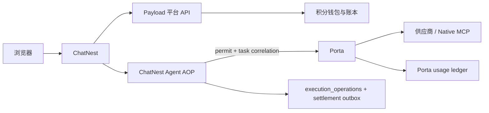
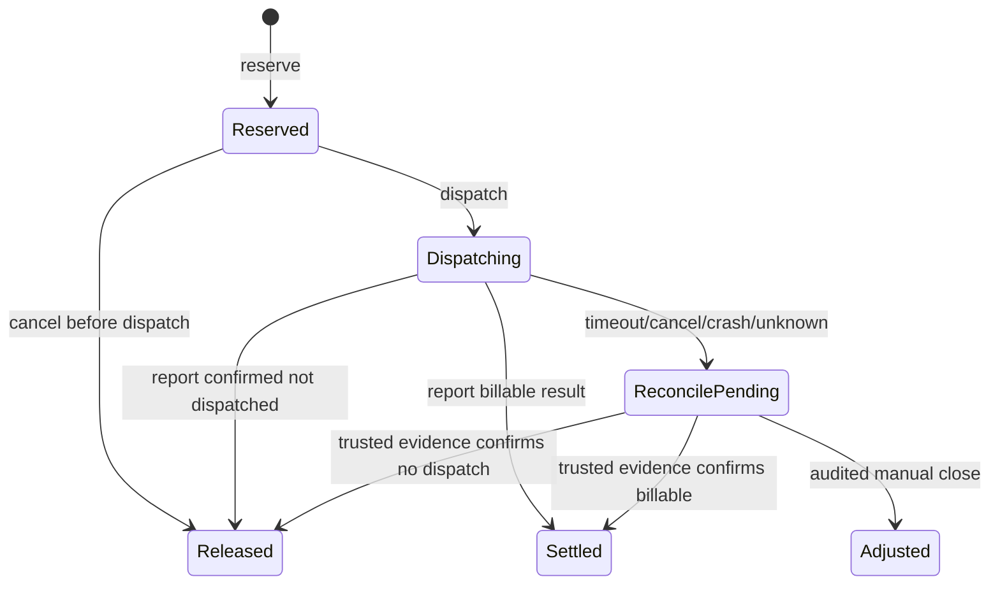

# 三方账户、积分与 Porta 工具扣分设计

日期：2026-10-30（America/New_York）  
状态：设计已冻结，待实现  
适用仓库：ChatNest、Porta；Payload 平台仓库当前未在工作区，本文同时作为平台业务应用的接口契约。

## 1. 目标与边界

本轮建立一套由 ChatNest、独立 Payload 平台、Porta 共同遵守的用户账户、权益、积分和工具执行协议。

- Payload 平台是账户、角色、权益、工具价格、钱包、积分账本和结算状态的唯一写入方。
- ChatNest 是用户会话、资源属主、Agent 编排、审批和本地执行状态的写入方。
- Porta 是工具执行、供应商访问、供应商用量和工具执行收据的写入方。
- 用户积分与供应商货币成本、供应商 credits、ChatNest 证据账分开保存。
- 关闭平台积分能力时，Porta 仍可按 standalone 模式独立运行；connected 模式没有免费旁路。
- 不把 Payload 依赖安装进 ChatNest，不把 ChatNest 数据库直接暴露给 Payload，不把用户钱包放入 Porta。

## 2. 三方容器与调用方向



调用方向固定为：

1. 浏览器只调用 ChatNest 同源 API。
2. ChatNest 以服务凭据和用户平台会话调用 Payload。
3. ChatNest 以 Porta 服务令牌调用 Porta；用户凭据和 points 不下发浏览器。
4. Porta 不回调浏览器，不从用户输入读取积分，不把平台钱包写入本地账本。

## 3. TypeScript 契约原则

三方均使用 TypeScript，协议实现采用以下机制：

- 领域状态使用判别联合，禁止字符串状态在业务层自由流转。
- 所有跨 HTTP 边界 DTO 由 `zod` schema 解析后再进入领域代码。
- `OperationId`、`AttemptId`、`HoldId`、`ReceiptId` 使用 branded string，避免把普通字符串混用。
- 金额和积分使用十进制字符串传输，平台内部使用 PostgreSQL `bigint`。
- 工具身份只使用稳定 canonical key：`provider/platform/api`。
- AOP 使用泛型 `AroundCall<T>`，让 REST、MCP、Native MCP 和测试夹具共享同一切面类型。
- 状态转换采用纯函数，使用 `never` exhaustive check，非法转移在编译期和运行时同时暴露。

示意类型：

```ts
type Brand<T, Name extends string> = T & { readonly __brand: Name };
type OperationId = Brand<string, "OperationId">;
type AttemptId = Brand<string, "AttemptId">;
type HoldId = Brand<string, "HoldId">;

type ToolIdentity = {
  provider: string;
  platform: string;
  api: string;
};

type ChargeMode = "attempt" | "success";
```

## 4. 平台 API v1

前缀：`/api/platform/v1`。

### 4.1 发现与身份

| 方法 | 路径 | 作用 |
|---|---|---|
| GET | `/capabilities` | 返回平台 ID、协议主版本、启用能力 |
| POST | `/identity/register` | 创建 Payload 用户并返回已验证主体 |
| POST | `/identity/login` | Payload 原生认证包装 |
| POST | `/identity/refresh` | 刷新平台会话 |
| POST | `/identity/logout` | 撤销平台会话 |
| GET | `/identity/me` | 返回主体、账号状态和平台会话信息 |
| GET | `/me/access` | 返回权限、模型/工具目录、限额和 `policyRevision` |
| GET | `/me/wallet` | 返回余额、冻结量、可用积分和更新时间 |
| GET | `/me/ledger` | 返回本人积分账本，游标分页 |

### 4.2 工具操作账务

| 方法 | 路径 | 作用 |
|---|---|---|
| POST | `/operations/reserve` | 校验账户、权益和余额，创建积分预留 |
| POST | `/operations/{operationId}/dispatch` | 原子消费派发资格，生成一次执行许可 |
| POST | `/operations/{operationId}/report` | 按 Porta 收据结算、释放或转待核对 |
| GET | `/operations/{operationId}` | 查询操作状态，支持响应丢失恢复 |
| POST | `/operations/{operationId}/cancel` | 未派发时释放预留；已派发时转入核对 |

所有写请求都要求：

- `Authorization: Bearer <service-token>`；
- 已登录用户通过独立的 `X-Platform-User-Token` 传递；
- `Idempotency-Key`；
- `X-Request-Id`；
- `apiVersion`。

服务端不信任 body 中的 `userId`、`points`、`role`、`price` 或 `accountId`。

## 5. 工具价格与统一 env

### 5.1 统一配置格式

启动初期允许使用一个平台环境变量作为价格种子：

```dotenv
PLATFORM_TOOL_POINTS_JSON={"version":"2026-10-30.1","default":"deny","tools":{"onebound/1688/item_search":{"points":"2","unit":"call","chargeMode":"attempt"},"onebound/1688/item_get":{"points":"3","unit":"call","chargeMode":"attempt"},"native_mcp/alibaba1688_product/find_product":{"points":"5","unit":"call","chargeMode":"attempt"}}}
```

约束：

- `points` 只能是非负十进制整数字符串。
- `unit` 一期固定为 `call`，预留 `page`、`record`、`token` 但不提前实现。
- `chargeMode=attempt` 表示真实出站一次即扣；`success` 表示成功结果才扣。
- `tools/list`、发现、校验失败和审批拒绝不进入用户积分账。
- `default=deny` 时，未配置的业务工具在 connected 模式拒绝执行，不隐式按免费处理；明确配置 `points="0"` 才表示平台承担的免费工具。
- 价格版本在 reserve 时锁定，后续改价不回写历史账本。

正式运营时，Payload 的 `tool_prices` 表为唯一运行时价格源；环境变量只用于首次种子、测试和灾备，不让 ChatNest 与 Porta 各自保存一份价格。

### 5.2 价格与供应商成本分离

平台积分价格字段：`points`、`unit`、`chargeMode`、`version`。  
Porta 供应商成本字段：`unitPrice`、`rates`、`estimate`、`actualCost`。  
两者不换算、不互相覆盖、不把供应商免费当成平台免费。

## 6. 账务状态机



平台 operation 至少保存：

- `operationId`、`attemptId`、`subjectId`、`hostId`、`runId`；
- canonical tool identity；
- 价格快照和 `policyRevision`；
- reserved/captured/released points；
- 原子状态和版本号；
- `receiptId`、`receiptRevision`、供应商来源引用；
- 幂等键和请求摘要；
- 审计操作者和修正原因。

余额不直接编辑：

```text
available = ledgerBalance - frozen
ledgerBalance >= frozen >= 0
```

同一事务内更新账户、operation、账本事件和 outbox。重复 reserve/dispatch/report 只返回原结果；同键不同摘要返回 409。

## 7. Porta 收据与 permit

Porta 保持独立，但 connected 模式下可要求一个由平台或 ChatNest 传递的签名 permit。

permit 绑定：

- `operationId`
- `attemptId`
- canonical tool identity
- `pointsVersion`
- `chargeMode`
- `hostId`
- `keyId`

permit 可以有短期的密码学有效期用于防重放；这不等于积分 hold 自动到期。积分 hold 的释放仍由明确的 cancel、report 或人工核对完成。

Porta 不接受客户端指定 points。Porta 只验证签名、绑定关系和一次性 attempt，然后写入自己的 usage ledger。

收据示意：

```ts
type PortaUsageReceipt = {
  receiptId: Brand<string, "ReceiptId">;
  operationId: OperationId;
  attemptId: AttemptId;
  identity: ToolIdentity;
  outcome: "response" | "timeout" | "cancelled" | "network_error" | "response_too_large";
  httpStatus?: number;
  supplierUnits: Record<string, number>;
  receiptRevision: number;
  signature: string;
};
```

收据不进入 Agent prompt，不写入用户可编辑消息，不包含原始参数、Key、响应正文或案件材料。

## 8. ChatNest AOP 执行边界

ChatNest 在 `createAgentRuntime()` 的动态 MCP 工具执行外层增加统一 decorator：

```ts
type AroundToolCall = <T>(
  context: {
    identity: ToolIdentity;
    operationId: OperationId;
    attemptId: AttemptId;
    toolCallId: string;
    argsDigest: string;
  },
  next: () => Promise<T>,
) => Promise<T>;
```

逻辑顺序：

1. 判断是否为 Porta 业务工具。
2. 为本次工具调用创建 operation/attempt。
3. 调用平台 reserve。
4. 调用平台 dispatch，取得 permit。
5. 以 `AsyncLocalStorage` 将 permit 绑定到本次 MCP transport fetch；不把 permit 放进模型工具参数。
6. 执行 `remote.execute` 一次，禁止业务重试。
7. 读取 Porta 收据并调用平台 report。
8. 将结果继续交给现有 evidence ledger、来源表和 Agent。

审批拒绝、能力范围失效、参数校验失败和 reserve 失败发生在出站之前，不扣积分。

模型调用本身可作为独立 `model` operation；Porta 工具作为独立 `tool` operation，账本分组展示，避免一次 Agent 任务被误解成一次调用。

## 9. 错误和故障规则

| 场景 | 处理 |
|---|---|
| 余额不足 | 平台返回 `409 INSUFFICIENT_CREDITS`，Porta 不出站 |
| 平台不可达，尚未 reserve | connected 模式暂停，不切 standalone |
| reserve 响应丢失 | 用同一幂等键查询，不重复预留 |
| dispatch 响应丢失 | 查询 operation，不重复派发 |
| Porta 未收到 permit | 403，供应商不出站 |
| 供应商明确失败 | 按 `chargeMode` 结算或释放 |
| 超时、取消、进程崩溃 | `ReconcilePending`，不立即退款、不自动重试 |
| report 响应丢失 | settlement outbox 重试同一幂等命令 |
| Porta ledger 写失败 | Porta fail-closed，阻止后续出站 |
| ChatNest 结果已成功但 report 失败 | 保留结果和 outbox，界面不显示“结算完成” |

## 10. TypeScript 实现分层

### ChatNest

- `server/domain/billing/`：品牌 ID、状态联合、价格/收据 DTO、纯状态转移。
- `server/application/platform/`：平台 HTTP 客户端、身份和权益适配。
- `server/application/chat/`：`ExecutionGate` 和工具 decorator 装配。
- `server/infrastructure/persistence/drizzle/`：operation、receipt、outbox、external identity 表。
- `server/shared/env.ts`：平台模式、平台 URL、服务 token、签名公钥和 env JSON 解析。

### Porta

- `apps/server/src/billing/points.ts`：permit/receipt schema 与验证。
- `apps/server/src/billing/middleware.ts`：统一 `AroundCall` 组合器。
- `apps/server/src/billing/meter.ts`：保留现有供应商成本计量，接入 receipt middleware，不拥有钱包。
- `apps/server/src/config/`：`PORTA_BILLING_MODE=off|receipt|required` 等运行配置。

### Payload 平台

- 账户、角色、权益、`tool_prices`、wallet、ledger、operations、outbox 由平台业务应用实现。
- Payload Collection 不直接开放钱包余额 CRUD。
- 账务表由专用事务仓储管理，所有调整必须带幂等键、操作者和原因。

## 11. 验收门槛

必须覆盖：

1. 两个用户并发 reserve，余额不透支。
2. 同一 reserve/dispatch/report 幂等重放只入账一次。
3. 两个 ChatNest 进程竞争同一 operation，仅一个进入 `sending`。
4. 工具调用前停止不出站且释放冻结。
5. 工具调用后停止进入待核对，不自动重发。
6. Porta 直接调用在 `required` 模式没有 permit 时被拒绝。
7. 价格变更只影响新 operation。
8. `tools/list` 不扣用户积分。
9. 供应商成本账和用户积分账数值独立。
10. ChatNest、Porta、平台任一响应丢失都能通过幂等查询恢复。

本设计不实现支付、订阅续费、邀请、积分到期、团队钱包或自动周期发放。
